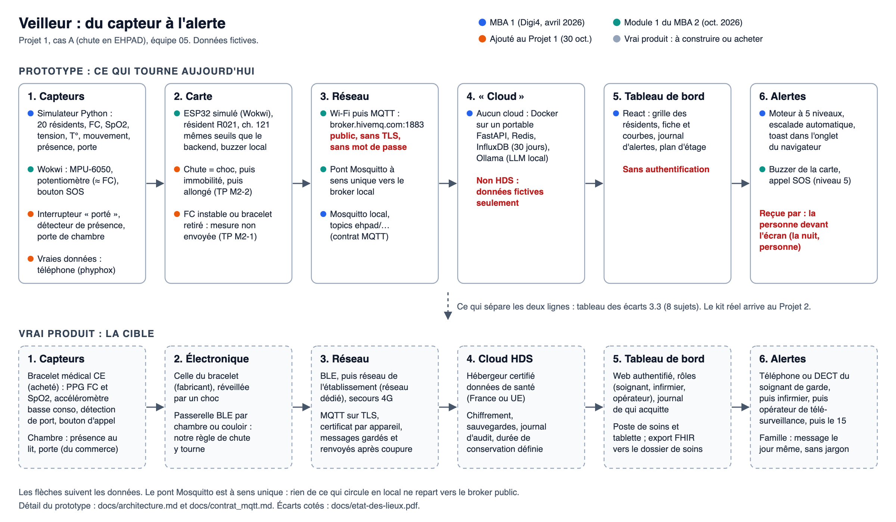

# Projet 1 — Dossier de cadrage

MBA 2 Santé, IA & IoT — Epitech — 2026-2027 · journée du 30 octobre 2026 · équipe 05

> Modèle d'origine : [`P1_Dossier_de_cadrage_modele.pdf`](P1_Dossier_de_cadrage_modele.pdf).
> Règles du dossier : une donnée inventée ou non vérifiée est marquée **hypothèse** ou **à vérifier**.
> Aucune donnée de vrai patient : tous les personnages sont fictifs. Aucun mot de passe.

| Heure | Exercice | Partie | État |
| --- | --- | --- | --- |
| 09:45-10:00 | Lancement : les rôles | [Page de garde](#page-de-garde) | fait |
| 10:00-11:15 | Exercice 1 — Le besoin | [Partie 1](#partie-1--le-besoin-exercice-1) | fait |
| 11:30-12:30 | Exercice 2 — La phrase et la classe | [Partie 2](#partie-2--la-phrase-et-la-classe-exercice-2) | fait |
| 14:00-15:00 | Exercice 3 — L'architecture | [Partie 3](#partie-3--larchitecture-exercice-3) | fait |
| 15:00-16:30 | Exercice 4 — La preuve de concept | [Partie 4](#partie-4--la-preuve-de-concept-exercice-4) | 4.1 fait (Wokwi P1 testé) ; **4.2 et 4.3 à finir avant le 13 novembre** |
| 16:30-17:00 | Bilan | [Bilan](#bilan--les-3-tâches-pour-le-13-novembre) | à finir avant le 13 novembre |

---

## Page de garde

| | |
| --- | --- |
| Nom de code du produit | **Veilleur** : comme le veilleur de nuit de l'EHPAD, il veille quand l'équipe ne peut pas être partout |
| Projet (A, C, D, F ou souris) | **A — chute** : détection de chute et de malaise chez les résidents d'EHPAD |
| Groupe et campus | Équipe 05 — Epitech Bordeaux |
| Pilote (planning, dépôts) | Cedric Usannaz |
| Référent technique (Wokwi, MQTT, tableau de bord) | Cedric Usannaz |
| Référent réglementaire (phrase de notice, classe) | Fares Mansour |
| Référent risques et données | Titouan Brunet |
| Lien du dépôt Git | https://github.com/Usannazcedric/monitoring-ehpad |
| Lien du tableau blanc | Pas de tableau blanc en ligne : la partie 1 a été travaillée directement dans ce dossier |

4 rôles pour 3 personnes : Cedric cumule pilote et technique (il porte déjà le dépôt et le firmware Wokwi du module 1). Titouan prend les risques et données, le plus gros chantier du 13 novembre (analyse de risques et AIPD).

---

## Partie 1 — Le besoin (exercice 1)

> **Exercice 1 (10:20-11:15) — On part du patient, pas du capteur.**
> 1. Le contexte : remplissez le tableau 1.1 et écrivez le problème en une phrase.
> 2. Les 4 personas : patient, aidant, soignant, opérateur (tableau 1.2).
> 3. Le parcours : au moins 3 moments de mesure et 3 moments de rupture (tableau 1.3).

### 1.1 Le contexte

| Question | Notre réponse |
| --- | --- |
| Pour qui ? | Les **résidents d'EHPAD à risque de chute ou de malaise** : personnes très âgées, fragiles, souvent atteintes de plusieurs maladies, parfois de troubles cognitifs. Beaucoup ne peuvent pas, ou ne pensent pas à, appeler à l'aide seules. |
| Où ? | Dans l'EHPAD, surtout **dans la chambre** (lever du lit, trajet vers les toilettes, salle de bain), mais aussi dans les couloirs et la salle commune. Le moment critique est **la nuit**, quand l'équipe est la plus réduite. |
| Ce qui doit alerter | 1. **Une chute** : choc suivi d'une immobilité au sol. 2. **Un malaise** : fréquence cardiaque anormale, SpO2 basse (< 93 %, seuil du cahier des charges), absence de mouvement prolongée. 3. **Une sortie de chambre la nuit** d'un résident désorienté. 4. **Une dégradation lente** des constantes qui annonce un risque. 5. **Un capteur muet** (non porté, batterie vide, hors réseau) : un silence ne doit jamais passer pour « tout va bien ». |
| Qui est concerné ? | Le **résident** ; les **aides-soignants et infirmiers de garde** (en premier la nuit) ; l'**infirmier coordinateur** et le **médecin coordonnateur** ; la **famille** (aidant) ; la **direction** de l'EHPAD ; un **opérateur de télésurveillance** si la supervision de nuit est externalisée ; le **SAMU (15)** pour les urgences vitales. |
| Comment ça se passe aujourd'hui ? | **Rondes de nuit** à intervalle fixe (toutes les 2 h environ, **hypothèse, à vérifier** auprès d'un EHPAD). **Sonnette ou médaillon d'appel**, qui suppose que le résident soit conscient, le porte et pense à appuyer. Une chute peut n'être **découverte qu'à la ronde suivante ou au matin**. Les constantes sont prises **ponctuellement** (**hypothèse** : une fois par jour à une fois par semaine selon le résident) et notées dans le dossier de soins. Effectif de nuit : 2 soignants pour environ 80 résidents (**hypothèse, à vérifier**). |
| Quelle décision notre mesure aide-t-elle à prendre ? Qui la prend ? | **Tout de suite** : le **soignant de garde** décide d'aller dans telle chambre maintenant, laquelle en priorité si plusieurs alertes tombent ensemble, et s'il faut appeler l'infirmier, le médecin ou le 15. **À moyen terme** : l'**infirmier coordinateur** et le **médecin coordonnateur** adaptent le plan de prévention des chutes du résident à partir de l'historique (chutes, levers nocturnes, tendances). La mesure **aide à décider** ; elle ne pose pas de diagnostic et ne décide pas à la place du soignant. |

**Le problème en une phrase :**

> « Aujourd'hui, **l'équipe de nuit d'un EHPAD** ne peut pas **savoir à temps qu'un résident est tombé ou fait un malaise dans sa chambre** parce qu'**elle dépend de rondes espacées et d'un bouton d'appel que le résident ne peut pas ou ne pense pas à utiliser**, ce qui entraîne **des stations prolongées au sol et des prises en charge tardives** (hypothermie, déshydratation, escarres, hospitalisation, perte d'autonomie). »

**Repères chiffrés**

| Donnée | Source | Statut |
| --- | --- | --- |
| 10 000 décès par an en France liés aux chutes des personnes âgées | Cahier des charges du projet (MBA 1), [`docs/cahier-des-charges-projet2.pdf`](../docs/cahier-des-charges-projet2.pdf) | **à vérifier** (source primaire : Santé publique France) |
| Rester au sol plus d'une heure aggrave fortement le pronostic | Notion couramment citée en gériatrie | **à vérifier** (trouver la publication) |
| Rondes de nuit toutes les 2 h, 2 soignants pour 80 résidents | Ordre de grandeur, aucune source | **hypothèse** |

### 1.2 Les 4 personas

Personnages inventés mais réalistes. Les noms, âges et citations sont **fictifs**.

| | Patient | Aidant | Soignant | Opérateur de télésurveillance |
| --- | --- | --- | --- | --- |
| Profil (âge, situation) | **Jeanne**, 87 ans, résidente depuis 2 ans, veuve. Arthrose, hypertension traitée, troubles de mémoire légers. Marche avec un déambulateur. Deux chutes la nuit en allant aux toilettes l'an dernier. | **Philippe**, 58 ans, fils de Jeanne, cadre, vit à 300 km. Vient une fois par mois, appelle deux fois par semaine. Référent famille auprès de l'EHPAD. | **Sarah**, 34 ans, aide-soignante de nuit depuis 8 ans. En binôme pour environ 80 résidents répartis sur 3 étages (**hypothèse**). | **Thomas**, 41 ans, opérateur sur une plateforme de télésurveillance qui supervise la nuit plusieurs EHPAD du groupe. Ancien ambulancier. |
| Objectif | Garder son autonomie (se lever seule la nuit) sans avoir peur de rester au sol. Ne pas se sentir « surveillée ». | Être prévenu rapidement d'un événement important et être rassuré, sans recevoir tout le détail médical. | Savoir **où aller en priorité** et ne plus découvrir un résident au sol pendant une ronde. | **Qualifier vite** chaque alerte (vraie ou fausse), s'assurer qu'elle est prise en charge, escalader au 15 si besoin. |
| Freins aujourd'hui | Oublie le médaillon sur la table de nuit. N'ose pas sonner la nuit pour « ne pas déranger ». Retire ce qu'elle porte au poignet pour la toilette. Craint d'être filmée. | Apprend les chutes plusieurs jours après, par hasard. Difficile de joindre l'EHPAD. Culpabilité liée à la distance. | Rondes longues qui réveillent les résidents. Toutes les sonnettes se ressemblent (un verre d'eau ou une chute). Trop de bips : fatigue d'alarme. Pas d'écran dans le couloir, seulement le téléphone de service. | Une alerte arrive sans contexte (antécédents, consignes, soignant de garde). Impossible de distinguer un capteur hors ligne d'un résident immobile. |
| Aisance avec le numérique | **Très faible** : pas de smartphone. L'objet doit fonctionner **sans aucune action** de sa part. | **Bonne** : smartphone, applications, messagerie. | **Moyenne** : smartphone personnel, logiciel de soins rempli en fin de poste. | **Élevée** : multi-écrans, logiciels de supervision et de téléphonie. |
| Critère de succès | En cas de chute, un soignant arrive en moins de 10 min sans qu'elle ait appuyé sur quoi que ce soit (**hypothèse** de seuil). Elle garde l'objet au poignet jour et nuit sans s'en plaindre. | Il est informé **le jour même** d'une chute, par un message clair et sans jargon médical (avec l'accord de sa mère). | Au plus 2 fausses alertes par nuit (**hypothèse**). L'alerte se lit en 3 secondes sur l'appareil qu'elle porte déjà : chambre, niveau, motif. | 100 % des alertes de niveau 4 acquittées ou escaladées en moins de 3 min (règle d'escalade du cahier des charges). Chaque alerte est tracée. |
| Citation (inventée) | « Je ne veux pas déranger les filles la nuit, elles ont tellement de travail. » | « J'ai appris sa chute trois jours après, au détour d'une conversation. » | « On est deux pour 80 résidents, je ne peux pas être dans toutes les chambres. » | « Une alerte sans contexte, je ne sais pas si j'appelle le 15 ou l'aide-soignante. » |

### 1.3 Le parcours du patient

Les moments de mesure sont numérotés **M0 à M5**, les ruptures **R1 à R15**.

| Étape | Qui ? | Fait quoi ? | Moment de mesure ? | Ce qui peut casser (rupture) |
| --- | --- | --- | --- | --- |
| Décision d'utiliser l'objet | Médecin coordonnateur et infirmier coordinateur, avec la résidente et sa famille | Évaluent le risque de chute à l'entrée ou après une chute. Décident d'équiper. Informent et recueillent le consentement (finalité, données collectées, qui les voit). | **M0 — évaluation initiale** : grille ou test de risque de chute (test de marche chronométré, **à vérifier** avec un soignant), constantes de référence. | **R1** La résidente refuse : sentiment d'être surveillée. **R2** Elle ne peut pas consentir seule (troubles cognitifs) : il faut passer par la famille ou le tuteur. **R3** Critères flous : on équipe tout le monde ou personne. |
| Installation | Aide-soignant référent et référent technique de l'EHPAD | Posent le bracelet, l'associent à la résidente et à sa chambre dans le tableau de bord, installent les capteurs de chambre (présence, porte), déclenchent une alerte test. | **M1 — période de référence** : 7 jours de données pour apprendre le « normal » de la résidente (le modèle actuel s'entraîne sur 7 jours, aujourd'hui **synthétiques**). | **R4** Bracelet associé à la mauvaise résidente : alerte envoyée dans la mauvaise chambre. **R5** Wi-Fi absent ou faible dans la chambre (**à vérifier** sur site). **R6** Période de référence faussée si la résidente est malade cette semaine-là. |
| Usage quotidien | La résidente (porte l'objet), les soignants (rechargent, consultent) | Porte le bracelet jour et nuit et le retire pour la toilette. Les soignants le rechargent (**hypothèse** : une fois par semaine) et consultent le tableau de bord au poste. | **M2 — mesure continue** : mouvement en continu (accéléromètre), fréquence cardiaque et SpO2 à intervalle régulier, capteurs de chambre (présence au lit, ouverture de porte), tendance calculée sur 15 min. | **R7** Bracelet non remis après la toilette. **R8** Batterie vide. **R9** Perte de signal : le silence est pris pour « tout va bien ». |
| Alerte | Le système, vers le soignant assigné | Détecte une chute (chute libre, choc, immobilité), une constante hors seuil ou un risque prédit. Envoie une alerte de niveau 1 à 5 avec la chambre et le motif. | **M3 — l'événement** : pic d'accélération, immobilité au sol, SpO2 < 93 %, FC hors seuil, heure exacte de détection. | **R10** Chute lente (glissade le long du lit) non détectée. **R11** Fausse alerte (s'asseoir lourdement) répétée : les soignants n'y croient plus. **R12** L'alerte reste sur l'écran du poste et personne ne la voit la nuit. |
| Traitement de l'alerte | Aide-soignante de garde, infirmier, opérateur de télésurveillance, SAMU si niveau 5 | Acquitte l'alerte, va dans la chambre, évalue et relève la résidente, appelle l'infirmier, le médecin ou le 15, puis clôture avec un motif (vraie chute, fausse alerte). | **M4 — les délais** : détection → acquittement → arrivée dans la chambre, et le motif de clôture (sert à mesurer la performance réelle). | **R13** Soignante occupée ailleurs : l'alerte n'est pas acquittée et doit escalader (2→3 en 10 min, 3→4 en 5 min, 4→5 en 3 min). **R14** L'événement n'est pas reporté dans le dossier de soins (ressaisie à la main, oubli). |
| Fin | Médecin coordonnateur, équipe soignante, famille | Arrêt de l'objet : risque réévalué, résidente alitée, hospitalisation, départ ou décès. Le bracelet est dissocié, nettoyé, réattribué. Les données sont archivées puis supprimées. | **M5 — bilan** : chutes détectées, délais moyens, fausses alertes par nuit ; réévaluation périodique du risque (**hypothèse** : tous les 3 mois). | **R15** Bracelet réattribué sans réinitialiser le profil : le modèle garde le « normal » de l'ancienne résidente. Données conservées sans limite de durée (RGPD). Oubli de désactiver : alertes fantômes. |

---

## Partie 2 — La phrase et la classe (exercice 2)

> **Exercice 2 (11:45-12:15) — Même objet, autre phrase : autre statut.**
> 1. Écrivez votre phrase de notice (2.1).
> 2. Dispositif médical ou pas ? Classe et règle, avec le raisonnement (2.2).
> 3. Écrivez une variante bien-être et ce qu'elle change (2.3).

Point de départ : notre ligne 9 du TP M3-1 ([`analyses/m3/reponses.md`](../analyses/m3/reponses.md), question 5), reprise avec le produit tel qu'il est cadré en partie 1.

### 2.1 La phrase de notice

« [Produit] est destiné à [action] chez [patients] afin de [but]. »

**Notre phrase :**

> « **Veilleur** est destiné à **détecter automatiquement les chutes et à surveiller en continu la fréquence cardiaque et la saturation en oxygène** chez **les résidents d'EHPAD à risque de chute ou de malaise** afin d'**alerter sans délai le soignant de garde et de réduire le temps passé au sol**. »

Les mots qui font la classe : **détecter**, **surveiller**, **fréquence cardiaque**, **saturation en oxygène**, **malaise**. Ce sont eux que la partie 2.2 analyse.

**Ce que le produit ne fait pas :**

- **Il ne pose pas de diagnostic.** Il signale qu'un résident est au sol ou qu'une constante sort des seuils. Il ne dit pas pourquoi ni de quelle maladie il s'agit.
- **Il ne décide pas à la place du soignant.** Il n'appelle pas le 15 tout seul : l'escalade va vers un humain (aide-soignant, infirmier, opérateur), qui décide.
- **Il ne remplace pas les rondes de nuit.** Il les complète, et la notice le dit.
- **Il n'empêche pas la chute.** Dans cette version, il ne **prédit** pas non plus le risque de chute : le score de risque du prototype (IsolationForest) n'est pas revendiqué tant qu'il n'est pas validé sur des données réelles (écart T6 de l'état des lieux). Il est désactivé dans la version 1.
- **Il ne filme pas** et ne localise pas le résident hors de l'établissement.
- **Il n'est pas un moniteur de soins intensifs.** Il ne s'adresse pas aux patients instables qui ont besoin d'une surveillance hospitalière continue.

### 2.2 Statut et classe

| Question | Notre réponse et pourquoi |
| --- | --- |
| 1. Finalité médicale ? (diagnostiquer, surveiller, prévenir, traiter) | **Oui : c'est un dispositif médical** (article 2 du règlement (UE) 2017/745, dit MDR). La phrase revendique de **surveiller** des constantes (FC, SpO2) et de **détecter** deux événements de santé (chute, malaise) pour qu'un soignant intervienne. Elle vise aussi à **prévenir** une complication : la station prolongée au sol. Les utilisateurs sont des professionnels de santé, les personnes surveillées sont des patients fragiles. Aucune lecture « bien-être » ne tient. Au TP M3-1, le détecteur de chute (produit 7) était « à discuter » : c'est le mot « détecter » qui le fait basculer, et notre phrase le contient. |
| 2. Quelle règle ? (règle 10 : l'appareil qui mesure ; règle 11 : le logiciel) | **Les deux**, parce que le produit a deux parties. **Règle 10** pour le **bracelet** : c'est un dispositif actif destiné à surveiller des processus physiologiques vitaux (FC, SpO2). Il est en IIb dès lors que les variations de ces paramètres peuvent mettre le patient en **danger immédiat**, par exemple une désaturation ou une bradycardie au cours d'un malaise. **Règle 11** pour le **logiciel** (règle de chute, moteur d'alertes, tableau de bord) : il fournit l'information qui déclenche une décision de soin (« aller dans la chambre 121 maintenant »). Il surveille aussi des paramètres vitaux, donc IIb. Lecture MDCG 2019-11 (grille IMDRF) : situation **critique** × information qui **oriente** la prise en charge = IIb. Ce serait III si le logiciel diagnostiquait ou traitait lui-même ; or il déclenche une vérification par un humain. |
| 3. Quelle classe ? (la plus élevée) | **Classe IIb.** Annexe VIII, règle d'application 3.5 : quand plusieurs règles s'appliquent, la plus stricte l'emporte, et les deux mènent ici à IIb. C'est la même conclusion qu'au TP M3-1. **Variante à étudier :** une version « chute seule » (accéléromètre, sans FC ni SpO2) retomberait en **IIa, règle 11**. Une chute n'est pas un paramètre physiologique vital : on garde une finalité médicale, mais sans danger immédiat lié à la mesure. C'est une voie possible pour un premier marquage plus rapide. Classe **à confirmer** avec l'organisme notifié. |
| Organisme notifié ? (obligatoire dès IIa) | **Oui, obligatoire** (par exemple GMED en France). En IIb : procédure de l'annexe IX (audit du système qualité ISO 13485 et évaluation de la documentation technique). Il faut aussi : le cycle de vie logiciel IEC 62304, la gestion des risques ISO 14971 (le 13/11), l'aptitude à l'utilisation IEC 62366-1, la sécurité électrique et la CEM (IEC 60601-1 et -1-2), les alarmes (IEC 60601-1-8), une évaluation clinique, l'enregistrement EUDAMED avec IUD, puis la matériovigilance et un rapport de sécurité (PSUR) chaque année. |

### 2.3 La variante bien-être

**Phrase sans finalité médicale :**

> « **Veilleur Confort** est un bracelet d'appel destiné à permettre aux résidents d'EHPAD d'appeler l'équipe d'un simple appui, et à suivre leur activité de la journée (pas, temps de marche) afin de les encourager à rester actifs. »

Même boîtier, même accéléromètre. Ce qui change : plus de détection automatique, plus de FC ni de SpO2 présentées comme des mesures, plus de mot « chute » ni « malaise ».

**Ce que ça change** (statut, preuves, coût, délai, confiance des soignants), en 5 lignes :

1. **Statut** : plus de dispositif médical, donc ni classe ni organisme notifié. Il reste le marquage CE des produits électroniques (directive radio RED, CEM, RoHS). Le **RGPD, lui, ne change pas** : une activité rattachée à un résident nommé reste une donnée de santé probable (**à vérifier** dans l'AIPD du 13/11).
2. **Preuves** : plus d'évaluation clinique ni de validation de la détection, des tests fonctionnels suffisent. En contrepartie, on perd le droit d'écrire « détecte les chutes », y compris sur une plaquette commerciale.
3. **Coût et délai** : pas d'ISO 13485, d'IEC 62304, d'évaluation clinique ni d'audit de l'organisme notifié. La mise sur le marché prend quelques mois au lieu d'un an et demi à trois ans (**hypothèse**, ordre de grandeur non sourcé).
4. **Confiance des soignants** : faible. On retombe sur le bouton d'appel que Jeanne oublie sur sa table de nuit et ne pense pas à presser (freins de la partie 1, ruptures R7 et R9). Une chute avec perte de connaissance ne déclenche rien, donc le problème de la partie 1 n'est **pas** résolu.
5. **Risque** : si les EHPAD l'utilisent quand même pour « surveiller les chutes », ou si un commercial le présente ainsi, le produit sera requalifié en dispositif médical non conforme (ANSM). **Décision de l'équipe : on garde la phrase médicale.** La variante bien-être sert de point de comparaison, pas de produit.

---

## Partie 3 — L'architecture (exercice 3)

> **Exercice 3 (14:15-14:55) — Du capteur à l'alerte, du prototype au vrai produit.**
> 1. Dessinez le schéma de bout en bout ; marquez ce qui vient de MBA 1 (3.1).
> 2. Choisissez le capteur du vrai produit : fabriquer ou acheter, et pourquoi (3.2).
> 3. Remplissez le tableau des écarts : au moins 6 lignes (3.3).

Points de départ : [`docs/architecture.md`](../docs/architecture.md) et [`docs/etat-des-lieux.pdf`](../docs/etat-des-lieux.pdf). Ce dernier cote déjà 16 écarts, et leurs codes (T1 à T10, R1 à R6) sont repris en 3.3.

### 3.1 Le schéma de bout en bout

Source du schéma : [`figures/schema_bout_en_bout.svg`](figures/schema_bout_en_bout.svg). La ligne du haut montre le prototype, la ligne du bas le vrai produit visé. La couleur des étiquettes dit d'où vient chaque brique : **MBA 1** (projet Digi4, avril 2026), **module 1** du MBA 2 (firmware ESP32, octobre 2026) ou **Projet 1** (ajouts du 30 octobre).

| Étape | Dans le prototype | Repris de MBA 1 ? |
| --- | --- | --- |
| Capteurs | Deux sources. (1) Le **simulateur Python** : 20 résidents, FC, SpO2, tension, température, mouvement, détecteur de présence et porte de chambre, avec des scénarios injectables (chute, malaise cardiaque, fugue, dégradation lente). (2) La **carte simulée dans Wokwi** : accéléromètre MPU-6050, potentiomètre à la place du capteur de pouls, bouton SOS. Depuis le Projet 1 s'y ajoutent un interrupteur « bracelet porté », un détecteur de présence et un capteur de porte (partie 4.1). | **En partie.** Le simulateur Python vient de MBA 1. Les capteurs Wokwi viennent du module 1, puis du Projet 1. |
| Carte (ESP32) | ESP32 DevKit simulé dans Wokwi, résident R021, chambre 121. Il lit les capteurs, applique les mêmes seuils que le backend, fait sonner le buzzer et publie en MQTT. | **Non.** En MBA 1, aucune carte : le simulateur Python jouait ce rôle. |
| Réseau | Wi-Fi (`Wokwi-GUEST`), puis MQTT vers `broker.hivemq.com:1883`, un broker **public, sans TLS ni mot de passe**. Un pont Mosquitto rapatrie les topics sur le broker local. Le format des messages et la hiérarchie des topics sont ceux de MBA 1 ([`docs/contrat_mqtt.md`](../docs/contrat_mqtt.md)). | **Oui** pour le broker local Mosquitto et le contrat des messages. **Non** pour le broker public et le pont (module 1). |
| Cloud (hébergeur de données de santé) | **Aucun cloud, et rien de certifié HDS.** Le backend FastAPI, Redis (état courant), InfluxDB (historique sur 30 jours) et Ollama (LLM local) tournent dans Docker sur un ordinateur portable. Les données sont fictives. | **Oui**, inchangé (et c'est un écart : R3, T8). |
| Tableau de bord | Application React : grille des résidents triée par niveau d'alerte, fiche détaillée avec graphiques, journal d'alertes, plan de l'étage, personnel. Pas d'authentification. | **Oui**, inchangé : la carte publie au format Digi4, il n'y a pas une ligne à modifier. |
| Alertes (qui les reçoit ?) | Moteur à 5 niveaux avec escalade automatique si personne n'acquitte : 2→3 en 10 min, 3→4 en 5 min, 4→5 en 3 min, conformément au cahier des charges (`backend/app/alerts/escalation.py`). L'alerte s'affiche en **toast dans l'onglet du navigateur** ; la carte fait aussi sonner son **buzzer**. Elle n'est **reçue que par la personne devant l'écran** : la nuit, personne. | **Oui** pour le moteur et l'escalade. **Non** pour le buzzer (module 1). La diffusion vers le soignant reste à faire (écart T2). |

### 3.2 Le capteur du vrai produit

| Question | Réponse |
| --- | --- |
| Ce qu'on mesure | (1) **L'accélération sur 3 axes**, pour la chute : choc, puis immobilité, puis position allongée. (2) **La FC et la SpO2**, pour le malaise. (3) **Le port du bracelet** (contact avec la peau), pour qu'un silence ne passe jamais pour « tout va bien ». (4) Dans la chambre, **la présence au lit et l'ouverture de la porte** : une détection indépendante du bracelet, qui couvre les ruptures R7 et R10. |
| Capteur du prototype | MPU-6050 simulé dans Wokwi (plage ±8 g). **Potentiomètre** à la place de la FC, parce que Wokwi ne simule pas de capteur de pouls. Interrupteurs à la place de la détection de port et de la porte, détecteur de présence (PIR) Wokwi. **Smartphone avec phyphox** pour les vraies données d'accélération (partie 4.2). SpO2 seulement dans le simulateur Python. Le kit du Projet 2 apportera un vrai MAX30102 (capteur de pouls et d'oxygène) et un vrai MPU-6050. |
| Capteur du vrai produit | Un **bracelet de poignet déjà marqué CE comme dispositif médical**, qui mesure FC, SpO2 et accélération. Il doit **laisser tourner notre règle de chute**. Deux options : (a) un kit de développement qui l'exécute sur le bracelet ; (b) le bracelet envoie quelques secondes d'accélération brute (≥ 50 Hz) autour de chaque choc, quand son accéléromètre le réveille, et la passerelle décide. Envoyer l'accélération en continu par BLE viderait la batterie. Les constantes passent **par un profil BLE standard** : Heart Rate 0x180D et Pulse Oximeter 0x1822, vus au TP M2-3. Il doit tenir **≥ 7 jours** sur batterie (**hypothèse** d'exigence), être étanche IP67 et se désinfecter. Les capteurs de chambre (présence au lit, porte) viennent du commerce. Aucun modèle n'est encore choisi : comparatif fournisseurs **à faire**. |
| Fabriquer (build) ou acheter un dispositif CE existant (buy) ? | **Acheter le capteur, fabriquer le logiciel.** On achète le bracelet de mesure ; on développe la détection de chute, le moteur d'alertes, l'escalade et le tableau de bord. Notre valeur est là. |
| Pourquoi (délai, coût, preuves, dépendance) | **Délai** : un bracelet PPG avec SpO2, c'est de l'électronique, un boîtier étanche, les essais IEC 60601 et une validation clinique de la SpO2 selon ISO 80601-2-61 (désaturations contrôlées sur volontaires). Il faut plusieurs années (**hypothèse**). En achetant, un pilote en EHPAD devient possible dès le Projet 2. **Coût** : ces essais et la certification du matériel coûteraient des centaines de milliers d'euros (**hypothèse**), contre un bracelet du commerce à quelques centaines d'euros pièce (**à vérifier** sur devis). **Preuves** : le fabricant fournit sa déclaration de conformité et la précision mesurée de FC et SpO2 ; il nous reste à prouver notre détection et nos alertes. Le TP M2-1 a montré qu'un PPG au poignet se dégrade beaucoup avec le mouvement (erreur moyenne de 10,5 bpm pendant l'artefact contre 0,9 sans) : c'est un métier à part. **Dépendance** : c'est le prix à payer (interface fermée, arrêt de gamme, hausse des prix, données forcées vers le cloud du fabricant). Exigences au contrat : accès local aux données brutes en BLE standard, pas de cloud imposé (HDS), deux fournisseurs qualifiés. **Critère éliminatoire** : un bracelet qui ne donne accès ni à l'accélération autour d'un choc ni à son propre calcul, car notre détection de chute ne pourrait pas tourner. Il ne resterait alors que sa détection à lui, qu'il faudrait valider comme la nôtre. |

### 3.3 Les écarts entre prototype et produit

La dernière colonne renvoie aux écarts cotés dans [`docs/etat-des-lieux.pdf`](../docs/etat-des-lieux.pdf).

| Sujet | Prototype | Vrai produit | Ce qu'il faudra faire | État des lieux |
| --- | --- | --- | --- | --- |
| Capteur et précision | FC réglée à la main au potentiomètre. SpO2 inventée par le simulateur. Détection de chute réglée sur des **chutes de téléphone** (TP M2-2 : précision 1,00 et rappel 1,00, mais sur un jeu synthétique). | FC et SpO2 mesurées au poignet avec une précision déclarée par le fabricant. Chute détectée sur des chutes **humaines**, avec un taux de fausses alertes par nuit connu. | Choisir le bracelet et mesurer sa précision dans nos conditions (mouvement, peau âgée, mauvaise perfusion). Valider la détection sur un jeu public de chutes humaines (SisFall, UP-Fall ; licence **à vérifier**), puis dans un EHPAD. Viser au plus 2 fausses alertes par nuit (partie 1.2). | T1, T6, R4 |
| Énergie et autonomie | Carte alimentée par USB, Wi-Fi allumé en permanence, une publication toutes les 2 s. Avec le calculateur du module 2, cela donne **moins d'un jour** (0,9 jour) sur une LiPo de 1000 mAh. | ≥ 7 jours, recharge hebdomadaire sur socle, batterie faible signalée **avant** l'arrêt (**hypothèse** d'exigence). | Passer au BLE et à un accéléromètre basse consommation qui réveille la carte sur un choc. FC et SpO2 toutes les 5 min : 15 jours sur 1000 mAh, mais seulement 4,5 jours sur un bracelet de 300 mAh (calculateur du module 2, détail en 4.3). **Mesurer** la vraie consommation au Projet 2. Alerte technique sous 20 % de batterie (ligne 1 de l'analyse de risques). | — |
| Réseau | Wi-Fi vers un broker public. Si le réseau coupe, les messages sont perdus ; le Last Will de la carte n'est exploité par personne. | BLE vers une passerelle par chambre ou couloir, réseau de l'établissement avec secours 4G. Messages gardés en mémoire et renvoyés après coupure. Un capteur muet est signalé en quelques minutes. | Mesurer la couverture radio dans un vrai EHPAD (rupture R5). Faire lever par le backend une alerte technique « capteur hors ligne » à partir du message `offline`. Rendre persistantes les escalades en cours. | T7 |
| Sécurité (mots de passe, mises à jour) | MQTT anonyme, sans TLS (`allow_anonymous true`). Jeton InfluxDB en clair dans `docker-compose.yml`. Tableau de bord sans authentification : n'importe qui peut acquitter une alerte vitale. Aucune mise à jour à distance. | TLS, certificat propre à chaque appareil, comptes nominatifs avec rôles, journal de qui a acquitté quoi, mises à jour signées à distance (OTA), veille des vulnérabilités (MDCG 2019-16). | Au Projet 2 : TLS et identifiants par appareil, authentification du tableau de bord, secrets sortis du dépôt, plan de mises à jour. Le placeholder TLS est déjà prêt dans le firmware (`USE_TLS 1`). | T3, T4 |
| Boîtier, nettoyage, contact avec la peau | Aucun boîtier : carte simulée, téléphone pour les essais. | Bracelet étanche (douche), désinfectable avec les produits de l'établissement, matériaux testés pour le contact prolongé avec la peau (ISO 10993), confortable la nuit, fermoir que le résident ne perd pas. | Mettre ces exigences au cahier des charges fournisseur. Faire porter le bracelet jour et nuit par des résidents volontaires (ruptures R1 et R7). Écrire le protocole de nettoyage et de réattribution (rupture R15). | R5 |
| Statut réglementaire | Prototype pédagogique, non marqué CE, données fictives, broker public. | Dispositif médical de classe IIb (partie 2), avec organisme notifié, ISO 13485, IEC 62304, ISO 14971, évaluation clinique et matériovigilance. | Figer la phrase de notice (partie 2). Analyse de risques et AIPD le 13/11. Choisir l'organisme notifié. Écrire le plan d'évaluation clinique. | R1, R2 |
| Données et hébergement | Volumes Docker sur un portable, aucune sauvegarde. Le broker public voit passer les constantes de R021 (fictives). | Hébergeur certifié HDS, chiffrement, sauvegardes, durée de conservation définie, consentement du résident ou de son tuteur (rupture R2). | AIPD le 13/11. Choix de l'hébergeur HDS. Ne plus jamais utiliser de broker public dès qu'une donnée réelle existe. | R3, T8 |
| Diffusion de l'alerte | Toast dans l'onglet du navigateur. | Alerte sur l'appareil que le soignant porte déjà (téléphone de service ou DECT), avec acquittement et escalade. Famille prévenue le jour même par un message non médical. | Brancher les alertes sur l'appel malade de l'établissement ou sur des notifications push. Tester une nuit avec deux soignants (rupture R12). | T2, R5 |

---

## Partie 4 — La preuve de concept (exercice 4)

> **Exercice 4 (15:00-16:30) — Prouver le principe, sans attendre le matériel.**
> 1. Copiez votre projet Wokwi du module 1 et ajoutez les capteurs de votre projet (4.1).
> 2. Publiez en MQTT et vérifiez l'arrivée dans le tableau de bord (4.1).
> 3. Enregistrez une première série de vraies données dans `projet1/donnees/` (4.2).
>
> Jamais de chute humaine : le téléphone tombe sur un coussin.

Le projet Wokwi du module 1 ([`firmware/m1_wokwi/`](../firmware/m1_wokwi/)) est **copié** dans [`firmware/p1_wokwi/`](../firmware/p1_wokwi/), sans toucher à l'original. On y ajoute les capteurs de chambre et de port de la partie 3.2, et les traitements des TP M2-1 et M2-2.

### 4.1 Wokwi

| | |
| --- | --- |
| Lien du projet Wokwi | Module 1 (base) : https://wokwi.com/projects/476778339332099073. **Projet 1** : code dans [`firmware/p1_wokwi/`](../firmware/p1_wokwi/) (`diagram.json`, `sketch.ino`, `libraries.txt`). **Testé le 30/10 sur wokwi.com**, dans un projet sans compte, donc sans lien permanent. Compilation, Wi-Fi, NTP et MQTT OK ([journal série](../firmware/p1_wokwi/docs/journal-serie-test-2026-10-30.txt)). **Lien à créer** depuis le compte Wokwi de l'équipe (bouton *Save*), avant le 13 novembre. |
| Capteurs simulés (et ce qu'ils remplacent) | **MPU-6050** : l'accéléromètre du bracelet. **Potentiomètre** : le capteur de pouls (FC), que Wokwi ne simule pas. **Bouton rouge** : le bouton d'appel du bracelet (SOS, niveau 5). **Interrupteur 1 (GPIO 32)** : la détection de port, contact du bracelet avec la peau (*nouveau*). **Détecteur de présence PIR (GPIO 27)** : le capteur de présence de la chambre (*nouveau*). **Interrupteur 2 (GPIO 33)** : le capteur d'ouverture de la porte de chambre (*nouveau*). **Buzzer** : l'alarme locale. La SpO2 n'est pas simulée sur la carte : elle n'existe que dans le simulateur Python (R001 à R020). |
| Topic MQTT et contenu d'un message | Préfixe d'équipe `digi5/equipe-ehpad/ehpad/` (broker public partagé), puis les topics Digi4 : `vitals/resident/R021`, `motion/resident/R021`, `ambient/room/121` et `door/room/121` (*nouveaux*), `alerts/new`, `device/esp32-01/status`. Le pont Mosquitto les rapatrie en local, `ambient` et `door` compris ([`mosquitto.conf`](../mosquitto/config/mosquitto.conf)). Message `vitals` relevé pendant le test : `{"timestamp":"2026-10-30T16:10:40.361Z","resident_id":"R021","values":{"hr":85},"vitals":{"hr":85},"scenario":"normal","seq":1,"source":"esp32","device_id":"esp32-01","measured":["hr"],"hr_cv":0.014}`. `hr_cv` est la dispersion des 10 lectures de la fenêtre : au-dessus de 0,15, le message **n'est pas envoyé**. |
| Capture du tableau de bord | Montage P1 en simulation : [`montage-wokwi-p1.jpg`](../firmware/p1_wokwi/docs/montage-wokwi-p1.jpg). Tableau de bord : capture du module 1, même chaîne, SOS de niveau 5 reçu en moins d'une seconde ([`dashboard.png`](../firmware/m1_wokwi/docs/dashboard.png)). **Capture P1 à faire** : la stack n'a pas pu démarrer sur ce poste, disque plein (Docker n'a pas pu télécharger l'image Ollama de 2,7 Go). À faire avant le 13 novembre. |

**Ce que fait la carte P1, et comment le montrer** (déroulé de la démo, partie 3 du guide « démo idéale ») :

| Geste dans Wokwi | Ce que fait la carte | Ce qui arrive au tableau de bord |
| --- | --- | --- |
| Rien (situation normale) | Publie la FC, le mouvement et l'état de la chambre (toutes les 2 s et 5 s). | Fiche R021 à jour ; chambre 121 avec présence et porte. |
| Potentiomètre tourné vite | 10 lectures trop dispersées (CV > 0,15) : `[REJET FC] … NON envoyée`. | Rien de faux n'arrive : **une mesure non fiable n'est pas envoyée** (TP M2-1). |
| Potentiomètre au-delà de 140 bpm | Buzzer, alerte locale de niveau 4. | Alerte **Urgence** levée par le backend à partir des `vitals`. |
| MPU-6050 : choc (axe X à 2 g), puis X = 1 g et Z = 0 g, puis immobile 3 s | Choc, immobilité, rotation de 90° : `fall detected`, buzzer, `activity = "fall"` envoyée tout de suite. | Alerte **Urgence, chute** (niveau 4), qui escalade si personne n'acquitte. |
| MPU-6050 : choc, puis retour à la position de départ | Choc, immobilité, mais pas de rotation : `[CHUTE ECARTEE] … assis lourdement ?`. Le journal série dit que la règle naïve du module 1, elle, aurait sonné. | Rien : **pas de fausse alerte**. |
| Interrupteur 1 basculé (bracelet retiré) | Plus aucune mesure envoyée ; au bout de 30 s, alerte technique publiée. Dans le vrai produit, ce serait 30 min (analyse de risques M3-2). | Alerte **Attention : bracelet non porté**. Un silence n'est jamais lu comme « tout va bien ». |
| Interrupteur 2 basculé, ou mouvement dans la chambre (PIR) | Publie `door = 1`, ou `pir = 1`, tout de suite. | État de la chambre 121 mis à jour (page Mouvements). |
| Bouton rouge | Alerte publiée, niveau 5, buzzer. | **Danger vital : appel SOS du résident**, en moins d'une seconde (déjà démontré au module 1). |

**Vérifié dans Wokwi le 30/10** ([journal série](../firmware/p1_wokwi/docs/journal-serie-test-2026-10-30.txt)) :
- **Situation normale** : un message `vitals` toutes les 2 s, `hr_cv` entre 0,013 et 0,022.
- **Bracelet retiré** : plus aucun `vitals`, puis alerte de niveau 2 publiée 30 s plus tard.
- **Chambre** : porte ouverte, puis présence détectée.
- **Chute** : choc de 2,24 g, immobilité, rotation de 90°, alerte de niveau 4 et buzzer.
- **Choc sans changement de position** (2,55 g) : écarté par notre règle, alors que la règle naïve du module 1 aurait sonné.

**Pas encore démontré en simulation** :
- **Rejet d'une FC instable** : la logique est là, mais il faut tourner le potentiomètre à la main pendant la démo.
- **Arrivée des nouveaux messages sur le tableau de bord** : pas vérifiée aujourd'hui, la stack n'a pas pu démarrer (voir « Capture du tableau de bord » plus haut).

### 4.2 Les vraies données

_À remplir avant le 13 novembre : enregistrement phyphox la semaine du 2 novembre._

| | |
| --- | --- |
| Source (phyphox, jeu de données) | |
| Fichier dans `projet1/donnees/` | |
| Ce qu'on a enregistré (activités, durée) | |

### 4.3 Pour le 13 novembre

_À remplir avant le 13 novembre._

| | |
| --- | --- |
| Traitement (filtre, seuil, comptage) | |
| Alerte de bout en bout (capture) | |
| Autonomie calculée (calculateur du module 2) et hypothèses | |

---

## Bilan — Les 3 tâches pour le 13 novembre

> **Bilan (16:30-17:00)** : écrivez vos 3 tâches, puis déposez le dossier dans `projet1/` avant 18:00.

_À remplir avant le 13 novembre._

| Tâche | Qui | Pour quand |
| --- | --- | --- |
| | | |
| | | |
| | | |

_Le 13 novembre, on ajoutera deux parties : l'analyse de risques et l'analyse d'impact sur les données personnelles (AIPD)._
