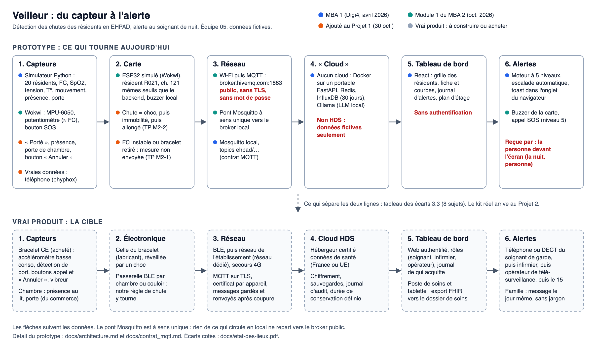
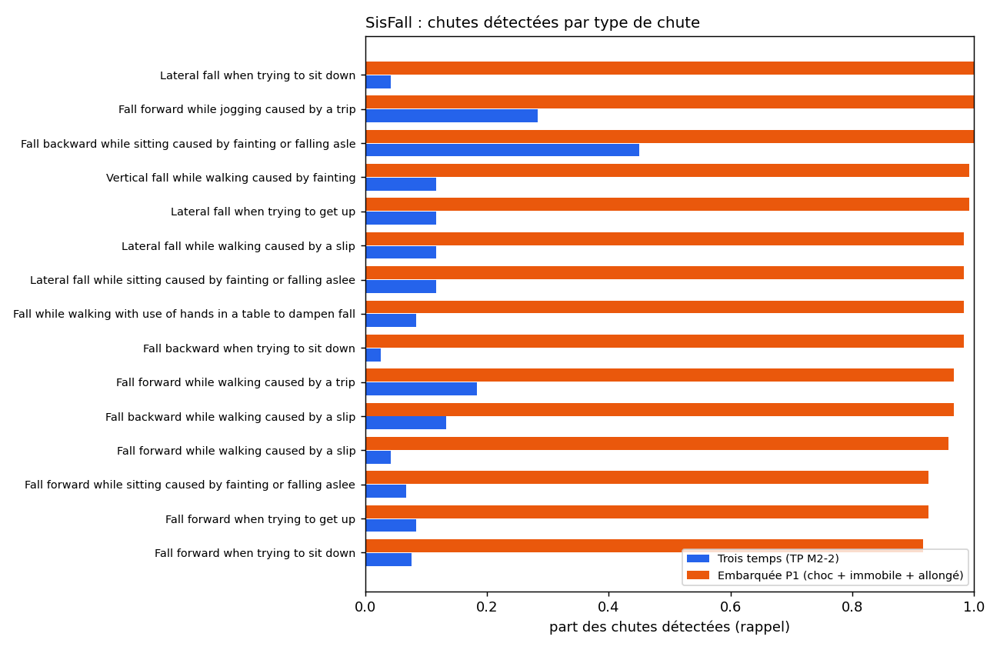
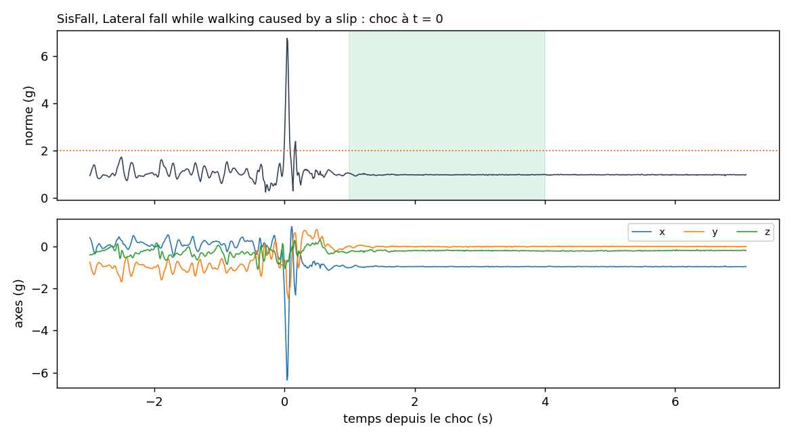

# Projet 1 — Dossier de cadrage

MBA 2 Santé, IA & IoT — Epitech — 2026-2027 · journées du 30 octobre et du 13 novembre 2026 · équipe 05 · **version 1 du dossier** (13/11)

> Modèles d'origine : [`P1_Dossier_de_cadrage_modele.pdf`](P1_Dossier_de_cadrage_modele.pdf) (parties 1 à 4) et parties 5-6 du 13/11.
> Règles du dossier : une donnée inventée ou non vérifiée est marquée **hypothèse** ou **à vérifier**.
> Aucune donnée de vrai patient : tous les personnages sont fictifs. Aucun mot de passe.

**Ce qui a changé le 13/11, après le suivi** : la finalité est recentrée sur la chute. Le pouls, l'oxygène et l'IA sortent de la version 1, et la classe passe de IIb à IIa (partie 2). Le bouton « Annuler » est ajouté (1.3, 4.1, 5.3), ainsi que le cas du bracelet retiré pour la recharge ou la toilette (5.3). La ligne Omnipod est retirée, et l'échelle de cotation est fixée en 5.1.

| Date | Exercice | Partie | État |
| --- | --- | --- | --- |
| 30/10 | Lancement : les rôles | [Page de garde](#page-de-garde) | fait |
| 30/10 | Exercice 1 — Le besoin | [Partie 1](#partie-1--le-besoin-exercice-1) | fait, recentré le 13/11 |
| 30/10 | Exercice 2 — La phrase et la classe | [Partie 2](#partie-2--la-phrase-et-la-classe-exercice-2) | fait, recentré le 13/11 (IIa) |
| 30/10 | Exercice 3 — L'architecture | [Partie 3](#partie-3--larchitecture-exercice-3) | fait |
| 30/10 et 13/11 | Exercice 4 — La preuve de concept | [Partie 4](#partie-4--la-preuve-de-concept-exercice-4) | fait : 4.1 testé dans Wokwi (bouton « Annuler » ajouté le 13/11), 4.2 sur le jeu public SisFall, 4.3 traitement, alerte et autonomie. **Reste : la capture de l'alerte sur le tableau de bord** |
| 30/10 | Bilan : les 3 tâches pour le 13/11 | [Bilan](#bilan-du-30-octobre--les-3-tâches-pour-le-13-novembre) | fait, état au 13/11 indiqué |
| 13/11 | Les risques pour le patient | [Partie 5](#partie-5--les-risques-pour-le-patient-norme-iso-14971) | fait |
| 13/11 | Les risques pour les données (AIPD) | [Partie 6](#partie-6--les-risques-pour-les-données--lanalyse-dimpact-aipd) | fait |
| 13/11 | Nos 3 priorités pour le 27/11 | [Dernière page](#dernière-page--nos-3-priorités-pour-le-27-novembre) | fait |

---

## Page de garde

| | |
| --- | --- |
| Nom de code du produit | **Veilleur** : comme le veilleur de nuit de l'EHPAD, il veille quand l'équipe ne peut pas être partout |
| Projet (A, C, D, F ou souris) | **A — chute** : détection des chutes des résidents d'EHPAD, alerte au soignant de nuit |
| Groupe et campus | Équipe 05 — Epitech Bordeaux |
| Pilote (planning, dépôts) | Cedric Usannaz |
| Référent technique (Wokwi, MQTT, tableau de bord) | Cedric Usannaz |
| Référent réglementaire (phrase de notice, classe) | Fares Mansour |
| Référent risques et données | Titouan Brunet |
| Lien du dépôt Git | https://github.com/Usannazcedric/monitoring-ehpad |
| Lien du tableau blanc | Pas de tableau blanc en ligne : la partie 1 a été travaillée directement dans ce dossier |

4 rôles pour 3 personnes : Cedric cumule pilote et technique (il porte déjà le dépôt et le firmware Wokwi du module 1). Titouan prend les risques et données, le plus gros chantier du 13 novembre (analyse de risques et AIPD).

---

## Partie 1 — Le besoin (exercice 1)

> **Exercice 1 (10:20-11:15) — On part du patient, pas du capteur.**
> 1. Le contexte : remplissez le tableau 1.1 et écrivez le problème en une phrase.
> 2. Les 4 personas : patient, aidant, soignant, opérateur (tableau 1.2).
> 3. Le parcours : au moins 3 moments de mesure et 3 moments de rupture (tableau 1.3).

**Le cadre en une phrase : détection des chutes des résidents en EHPAD, alerte au soignant de nuit.**

### 1.1 Le contexte

| Question | Notre réponse |
| --- | --- |
| Pour qui ? | Les **résidents d'EHPAD à risque de chute** : personnes très âgées, fragiles, souvent atteintes de plusieurs maladies, parfois de troubles cognitifs. Beaucoup ne peuvent pas, ou ne pensent pas à, appeler à l'aide seules. |
| Où ? | Dans l'EHPAD, surtout **dans la chambre** (lever du lit, trajet vers les toilettes, salle de bain), mais aussi dans les couloirs et la salle commune. Le moment critique est **la nuit**, quand l'équipe est la plus réduite. |
| Ce qui doit alerter | 1. **Une chute** : choc, puis immobilité au sol en position allongée. 2. **Un appel** de la résidente, par le bouton du bracelet. 3. **Un bracelet muet** (non porté, batterie vide, hors réseau) : un silence ne doit jamais passer pour « tout va bien ». **Hors de la version 1** : le malaise (pouls, oxygène), la sortie de chambre la nuit et la dégradation lente. Ce sont d'autres besoins, qui demanderaient d'autres capteurs et une classe plus haute (partie 2). |
| Qui est concerné ? | Le **résident** ; les **aides-soignants et infirmiers de garde** (en premier la nuit) ; l'**infirmier coordinateur** et le **médecin coordonnateur** ; la **famille** (aidant) ; la **direction** de l'EHPAD ; un **opérateur de télésurveillance** si la supervision de nuit est externalisée ; le **SAMU (15)** pour les urgences vitales. |
| Comment ça se passe aujourd'hui ? | **Rondes de nuit** à intervalle fixe (toutes les 2 h environ, **hypothèse, à vérifier** auprès d'un EHPAD). **Sonnette ou médaillon d'appel**, qui suppose que le résident soit conscient, le porte et pense à appuyer. Une chute peut n'être **découverte qu'à la ronde suivante ou au matin**. Les constantes sont prises **ponctuellement** (**hypothèse** : une fois par jour à une fois par semaine selon le résident) et notées dans le dossier de soins. Effectif de nuit : 2 soignants pour environ 80 résidents (**hypothèse, à vérifier**). |
| Quelle décision notre mesure aide-t-elle à prendre ? Qui la prend ? | **Tout de suite** : le **soignant de garde** décide d'aller dans telle chambre maintenant, laquelle en priorité si plusieurs alertes tombent ensemble, et s'il faut appeler l'infirmier, le médecin ou le 15. **À moyen terme** : l'**infirmier coordinateur** et le **médecin coordonnateur** adaptent le plan de prévention des chutes du résident à partir de l'historique (chutes, heures, délais d'intervention). La mesure **aide à décider** ; elle ne pose pas de diagnostic et ne décide pas à la place du soignant. |

**Le problème en une phrase :**

> « Aujourd'hui, **l'équipe de nuit d'un EHPAD** ne peut pas **savoir à temps qu'un résident est tombé dans sa chambre** parce qu'**elle dépend de rondes espacées et d'un bouton d'appel que le résident ne peut pas ou ne pense pas à utiliser**, ce qui entraîne **des stations prolongées au sol et des prises en charge tardives** (hypothermie, déshydratation, escarres, hospitalisation, perte d'autonomie). »

**Repères chiffrés**

| Donnée | Source | Statut |
| --- | --- | --- |
| 10 000 décès par an en France liés aux chutes des personnes âgées | Cahier des charges du projet (MBA 1), [`docs/cahier-des-charges-projet2.pdf`](../docs/cahier-des-charges-projet2.pdf) | **à vérifier** (source primaire : Santé publique France) |
| Rester au sol plus d'une heure aggrave fortement le pronostic | Notion couramment citée en gériatrie | **à vérifier** (trouver la publication) |
| Rondes de nuit toutes les 2 h, 2 soignants pour 80 résidents | Ordre de grandeur, aucune source | **hypothèse** |

### 1.2 Les 4 personas

Personnages inventés mais réalistes. Les noms, âges et citations sont **fictifs**.

| | Patient | Aidant | Soignant | Opérateur de télésurveillance |
| --- | --- | --- | --- | --- |
| Profil (âge, situation) | **Jeanne**, 87 ans, résidente depuis 2 ans, veuve. Arthrose, hypertension traitée, troubles de mémoire légers. Marche avec un déambulateur. Deux chutes la nuit en allant aux toilettes l'an dernier. | **Philippe**, 58 ans, fils de Jeanne, cadre, vit à 300 km. Vient une fois par mois, appelle deux fois par semaine. Référent famille auprès de l'EHPAD. | **Sarah**, 34 ans, aide-soignante de nuit depuis 8 ans. En binôme pour environ 80 résidents répartis sur 3 étages (**hypothèse**). | **Thomas**, 41 ans, opérateur sur une plateforme de télésurveillance qui supervise la nuit plusieurs EHPAD du groupe. Ancien ambulancier. |
| Objectif | Garder son autonomie (se lever seule la nuit) sans avoir peur de rester au sol. Ne pas se sentir « surveillée ». | Être prévenu rapidement d'un événement important et être rassuré, sans recevoir tout le détail médical. | Savoir **où aller en priorité** et ne plus découvrir un résident au sol pendant une ronde. | **Qualifier vite** chaque alerte (vraie ou fausse), s'assurer qu'elle est prise en charge, escalader au 15 si besoin. |
| Freins aujourd'hui | Oublie le médaillon sur la table de nuit. N'ose pas sonner la nuit pour « ne pas déranger ». Retire ce qu'elle porte au poignet pour la toilette. Craint d'être filmée. | Apprend les chutes plusieurs jours après, par hasard. Difficile de joindre l'EHPAD. Culpabilité liée à la distance. | Rondes longues qui réveillent les résidents. Toutes les sonnettes se ressemblent (un verre d'eau ou une chute). Trop de bips : fatigue d'alarme. Pas d'écran dans le couloir, seulement le téléphone de service. | Une alerte arrive sans contexte (antécédents, consignes, soignant de garde). Impossible de distinguer un capteur hors ligne d'un résident immobile. |
| Aisance avec le numérique | **Très faible** : pas de smartphone. L'objet doit fonctionner **sans aucune action** de sa part. | **Bonne** : smartphone, applications, messagerie. | **Moyenne** : smartphone personnel, logiciel de soins rempli en fin de poste. | **Élevée** : multi-écrans, logiciels de supervision et de téléphonie. |
| Critère de succès | En cas de chute, un soignant arrive en moins de 10 min sans qu'elle ait appuyé sur quoi que ce soit (**hypothèse** de seuil). Elle garde l'objet au poignet jour et nuit sans s'en plaindre. | Il est informé **le jour même** d'une chute, par un message clair et sans jargon médical (avec l'accord de sa mère). | Au plus 2 fausses alertes par nuit (**hypothèse**). L'alerte se lit en 3 secondes sur l'appareil qu'elle porte déjà : chambre, niveau, motif. | 100 % des alertes de niveau 4 acquittées ou escaladées en moins de 3 min (règle d'escalade du cahier des charges). Chaque alerte est tracée. |
| Citation (inventée) | « Je ne veux pas déranger les filles la nuit, elles ont tellement de travail. » | « J'ai appris sa chute trois jours après, au détour d'une conversation. » | « On est deux pour 80 résidents, je ne peux pas être dans toutes les chambres. » | « Une alerte sans contexte, je ne sais pas si j'appelle le 15 ou l'aide-soignante. » |

### 1.3 Le parcours du patient

Les moments de mesure sont numérotés **M0 à M5**, les ruptures **R1 à R15**.

| Étape | Qui ? | Fait quoi ? | Moment de mesure ? | Ce qui peut casser (rupture) |
| --- | --- | --- | --- | --- |
| Décision d'utiliser l'objet | Médecin coordonnateur et infirmier coordinateur, avec la résidente et sa famille | Évaluent le risque de chute à l'entrée ou après une chute. Décident d'équiper. Informent et recueillent le consentement (finalité, données collectées, qui les voit). | **M0 — évaluation initiale** : grille ou test de risque de chute (test de marche chronométré, **à vérifier** avec un soignant). | **R1** La résidente refuse : sentiment d'être surveillée. **R2** Elle ne peut pas consentir seule (troubles cognitifs) : il faut passer par la famille ou le tuteur. **R3** Critères flous : on équipe tout le monde ou personne. |
| Installation | Aide-soignant référent et référent technique de l'EHPAD | Posent le bracelet, l'associent à la résidente et à sa chambre dans le tableau de bord, installent les capteurs de chambre (présence, porte), déclenchent une alerte test. | **M1 — mise en service** : alerte test de bout en bout (chute simulée en secouant le bracelet, puis bracelet posé à plat), vérification de la couverture radio dans la chambre. | **R4** Bracelet associé à la mauvaise résidente : alerte envoyée dans la mauvaise chambre. **R5** Réseau absent ou faible dans la chambre (**à vérifier** sur site). **R6** Bracelet trop lâche ou porté par-dessus la manche : les chocs sont amortis. |
| Usage quotidien | La résidente (porte l'objet), les soignants (rechargent, consultent) | Porte le bracelet jour et nuit et le retire pour la toilette. Les soignants le rechargent (**hypothèse** : une fois par semaine) et consultent le tableau de bord au poste. | **M2 — mesure continue** : mouvement en continu (accéléromètre), port du bracelet et batterie (signe de vie toutes les 5 min), capteurs de chambre (présence au lit, ouverture de porte). | **R7** Bracelet non remis après la toilette. **R8** Batterie vide. **R9** Perte de signal : le silence est pris pour « tout va bien ». |
| Alerte | Le système, vers le soignant assigné | Détecte une chute (choc, puis immobilité, puis position allongée) ou reçoit un appel du bouton. Le bracelet vibre 30 s : la résidente peut **annuler** si elle va bien, et l'annulation est signalée au soignant. Sinon, l'alerte part avec la chambre et le motif. | **M3 — l'événement** : pic d'accélération, immobilité au sol, changement de position, heure exacte de détection. | **R10** Chute lente (glissade le long du lit) non détectée. **R11** Fausse alerte (s'asseoir lourdement) répétée : les soignants n'y croient plus. **R12** L'alerte reste sur l'écran du poste et personne ne la voit la nuit. |
| Traitement de l'alerte | Aide-soignante de garde, infirmier, opérateur de télésurveillance, SAMU si niveau 5 | Acquitte l'alerte, va dans la chambre, évalue et relève la résidente, appelle l'infirmier, le médecin ou le 15, puis clôture avec un motif (vraie chute, fausse alerte). | **M4 — les délais** : détection → acquittement → arrivée dans la chambre, et le motif de clôture (sert à mesurer la performance réelle). | **R13** Soignante occupée ailleurs : l'alerte n'est pas acquittée et doit escalader (2→3 en 10 min, 3→4 en 5 min, 4→5 en 3 min). **R14** L'événement n'est pas reporté dans le dossier de soins (ressaisie à la main, oubli). |
| Fin | Médecin coordonnateur, équipe soignante, famille | Arrêt de l'objet : risque réévalué, résidente alitée, hospitalisation, départ ou décès. Le bracelet est dissocié, nettoyé, réattribué. Les données sont archivées puis supprimées. | **M5 — bilan** : chutes détectées, délais moyens, fausses alertes par nuit ; réévaluation périodique du risque (**hypothèse** : tous les 3 mois). | **R15** Bracelet réattribué sans réinitialiser l'association : les alertes partent encore au nom de l'ancienne résidente. Données conservées sans limite de durée (RGPD). Oubli de désactiver : alertes fantômes. |

---

## Partie 2 — La phrase et la classe (exercice 2)

> **Exercice 2 (11:45-12:15) — Même objet, autre phrase : autre statut.**
> 1. Écrivez votre phrase de notice (2.1).
> 2. Dispositif médical ou pas ? Classe et règle, avec le raisonnement (2.2).
> 3. Écrivez une variante bien-être et ce qu'elle change (2.3).

Point de départ : notre ligne 9 du TP M3-1 ([`analyses/m3/reponses.md`](../analyses/m3/reponses.md), question 5), reprise avec le produit tel qu'il est cadré en partie 1.

### 2.1 La phrase de notice

« [Produit] est destiné à [action] chez [patients] afin de [but]. »

**Notre phrase** (recentrée sur la chute après le suivi du 13 novembre) :

> « **Veilleur** est destiné à **détecter automatiquement les chutes** chez **les résidents d'EHPAD à risque de chute** afin d'**alerter sans délai le soignant de nuit et de réduire le temps passé au sol**. »

Les mots qui font la classe : **détecter**, **chutes**, **alerter le soignant**. Ce sont eux que la partie 2.2 analyse.

**Pourquoi ni pouls, ni oxygène, ni IA dans la version 1** : ils ne servent pas à détecter une chute. Le pouls et l'oxygène visent le malaise, un autre besoin, qui ferait passer le produit en classe IIb. Le modèle d'IA du prototype n'est pas validé : il a été entraîné sur des données simulées. On les retire donc de la finalité. Le potentiomètre « pouls » de la carte Wokwi reste, mais seulement pour éprouver la chaîne MQTT héritée du module 1.

**Ce que le produit ne fait pas :**

- **Il ne pose pas de diagnostic.** Il signale qu'une résidente est au sol ; il ne dit pas pourquoi elle est tombée.
- **Il ne décide pas à la place du soignant.** Il n'appelle pas le 15 tout seul : l'escalade va vers un humain (aide-soignant, infirmier, opérateur), qui décide.
- **Il ne remplace pas les rondes de nuit.** Il les complète, et la notice le dit.
- **Il n'empêche pas la chute** et, dans cette version, ne la **prédit** pas.
- **Il ne mesure ni le pouls ni l'oxygène** et ne détecte pas les malaises.
- **Il ne filme pas, n'écoute pas** et ne localise pas la résidente hors de sa chambre.

### 2.2 Statut et classe

| Question | Notre réponse et pourquoi |
| --- | --- |
| 1. Finalité médicale ? (diagnostiquer, surveiller, prévenir, traiter) | **Oui : c'est un dispositif médical** (article 2 du règlement (UE) 2017/745, dit MDR). La phrase revendique de **détecter** un événement de santé, la chute, pour qu'un soignant intervienne. Elle vise aussi à **prévenir** une complication : la station prolongée au sol. Les utilisateurs sont des soignants, les personnes surveillées des patients fragiles. Au TP M3-1, le détecteur de chute (produit 7) était « à discuter » : c'est le mot « détecter » qui le fait basculer, et notre phrase le contient. |
| 2. Quelle règle ? (règle 10 : l'appareil qui mesure ; règle 11 : le logiciel) | **Règle 11**, pour le **logiciel** (règle de chute, alertes, tableau de bord) : il fournit l'information qui déclenche une décision de soin (« aller dans la chambre 121 maintenant »), donc **IIa**. Il ne surveille aucun paramètre physiologique vital : une chute n'en est pas un, ce qui écarte IIb. Ce n'est pas non plus III : il ne diagnostique ni ne traite, un humain décide. Lecture MDCG 2019-11 (grille IMDRF) : situation **sérieuse** × information qui **oriente** la prise en charge = IIa. **La règle 10 ne s'applique plus** : le bracelet mesure un mouvement, pas un processus physiologique vital. Seul, il relèverait de la règle 13 (classe I). |
| 3. Quelle classe ? (la plus élevée) | **Classe IIa** (annexe VIII, règle d'application 3.5 : la plus stricte des règles l'emporte). Pour comparer : la version du 30 octobre, avec pouls et oxygène pour le malaise, était en **IIb** (règles 10 et 11). Recentrer sur la chute fait donc baisser la classe, et avec elle la charge de preuves. Classe **à confirmer** avec l'organisme notifié. |
| Organisme notifié ? (obligatoire dès IIa) | **Oui, obligatoire** (par exemple GMED en France). En IIa : annexe IX (audit du système qualité ISO 13485 et évaluation de la documentation technique, sur échantillon), ou annexe XI. Il faut aussi : le cycle de vie logiciel IEC 62304, la gestion des risques ISO 14971 (partie 5), l'aptitude à l'utilisation IEC 62366-1, les alarmes (IEC 60601-1-8), une évaluation clinique, l'enregistrement EUDAMED avec IUD, puis la matériovigilance et un rapport de sécurité (PSUR) au moins tous les 2 ans. La sécurité électrique du bracelet (IEC 60601-1) est portée par son fabricant, puisqu'on l'achète (partie 3.2). |

### 2.3 La variante bien-être

**Phrase sans finalité médicale :**

> « **Veilleur Confort** est un bracelet d'appel destiné à permettre aux résidents d'EHPAD d'appeler l'équipe d'un simple appui, et à suivre leur activité de la journée (pas, temps de marche) afin de les encourager à rester actifs. »

Même boîtier, même accéléromètre. Ce qui change : plus de détection automatique, plus de mot « chute », plus d'alerte envoyée au soignant sans que la résidente appuie.

**Ce que ça change** (statut, preuves, coût, délai, confiance des soignants), en 5 lignes :

1. **Statut** : plus de dispositif médical, donc ni classe ni organisme notifié. Il reste le marquage CE des produits électroniques (directive radio RED, CEM, RoHS). Le **RGPD, lui, ne change pas** : une activité rattachée à un résident nommé reste une donnée de santé probable (**à vérifier** dans l'AIPD du 13/11).
2. **Preuves** : plus d'évaluation clinique ni de validation de la détection, des tests fonctionnels suffisent. En contrepartie, on perd le droit d'écrire « détecte les chutes », y compris sur une plaquette commerciale.
3. **Coût et délai** : pas d'ISO 13485, d'IEC 62304, d'évaluation clinique ni d'audit de l'organisme notifié. La mise sur le marché prend quelques mois au lieu d'un an et demi à trois ans (**hypothèse**, ordre de grandeur non sourcé).
4. **Confiance des soignants** : faible. On retombe sur le bouton d'appel que Jeanne oublie sur sa table de nuit et ne pense pas à presser (freins de la partie 1, ruptures R7 et R9). Une chute avec perte de connaissance ne déclenche rien, donc le problème de la partie 1 n'est **pas** résolu.
5. **Risque** : si les EHPAD l'utilisent quand même pour « surveiller les chutes », ou si un commercial le présente ainsi, le produit sera requalifié en dispositif médical non conforme (ANSM). **Décision de l'équipe : on garde la phrase médicale.** La variante bien-être sert de point de comparaison, pas de produit.

---

## Partie 3 — L'architecture (exercice 3)

> **Exercice 3 (14:15-14:55) — Du capteur à l'alerte, du prototype au vrai produit.**
> 1. Dessinez le schéma de bout en bout ; marquez ce qui vient de MBA 1 (3.1).
> 2. Choisissez le capteur du vrai produit : fabriquer ou acheter, et pourquoi (3.2).
> 3. Remplissez le tableau des écarts : au moins 6 lignes (3.3).

Points de départ : [`docs/architecture.md`](../docs/architecture.md) et [`docs/etat-des-lieux.pdf`](../docs/etat-des-lieux.pdf). Ce dernier cote déjà 16 écarts, et leurs codes (T1 à T10, R1 à R6) sont repris en 3.3.

### 3.1 Le schéma de bout en bout

Source du schéma : [`figures/schema_bout_en_bout.svg`](figures/schema_bout_en_bout.svg). La ligne du haut montre le prototype, la ligne du bas le vrai produit visé. La couleur des étiquettes dit d'où vient chaque brique : **MBA 1** (projet Digi4, avril 2026), **module 1** du MBA 2 (firmware ESP32, octobre 2026) ou **Projet 1** (ajouts du 30 octobre).

| Étape | Dans le prototype | Repris de MBA 1 ? |
| --- | --- | --- |
| Capteurs | Deux sources. (1) Le **simulateur Python** : 20 résidents, FC, SpO2, tension, température, mouvement, détecteur de présence et porte de chambre, avec des scénarios injectables (chute, malaise cardiaque, fugue, dégradation lente). Les constantes restent dans le simulateur, mais hors de la finalité de la version 1 (2.1). (2) La **carte simulée dans Wokwi** : accéléromètre MPU-6050, potentiomètre à la place du capteur de pouls, bouton SOS. Depuis le Projet 1 s'y ajoutent un interrupteur « bracelet porté », un détecteur de présence et un capteur de porte (partie 4.1). | **En partie.** Le simulateur Python vient de MBA 1. Les capteurs Wokwi viennent du module 1, puis du Projet 1. |
| Carte (ESP32) | ESP32 DevKit simulé dans Wokwi, résident R021, chambre 121. Il lit les capteurs, applique les mêmes seuils que le backend, fait sonner le buzzer et publie en MQTT. | **Non.** En MBA 1, aucune carte : le simulateur Python jouait ce rôle. |
| Réseau | Wi-Fi (`Wokwi-GUEST`), puis MQTT vers `broker.hivemq.com:1883`, un broker **public, sans TLS ni mot de passe**. Un pont Mosquitto rapatrie les topics sur le broker local. Le format des messages et la hiérarchie des topics sont ceux de MBA 1 ([`docs/contrat_mqtt.md`](../docs/contrat_mqtt.md)). | **Oui** pour le broker local Mosquitto et le contrat des messages. **Non** pour le broker public et le pont (module 1). |
| Cloud (hébergeur de données de santé) | **Aucun cloud, et rien de certifié HDS.** Le backend FastAPI, Redis (état courant), InfluxDB (historique sur 30 jours) et Ollama (LLM local) tournent dans Docker sur un ordinateur portable. Les données sont fictives. | **Oui**, inchangé (et c'est un écart : R3, T8). |
| Tableau de bord | Application React : grille des résidents triée par niveau d'alerte, fiche détaillée avec graphiques, journal d'alertes, plan de l'étage, personnel. Pas d'authentification. | **Oui**, inchangé : la carte publie au format Digi4, il n'y a pas une ligne à modifier. |
| Alertes (qui les reçoit ?) | Moteur à 5 niveaux avec escalade automatique si personne n'acquitte : 2→3 en 10 min, 3→4 en 5 min, 4→5 en 3 min, conformément au cahier des charges (`backend/app/alerts/escalation.py`). L'alerte s'affiche en **toast dans l'onglet du navigateur** ; la carte fait aussi sonner son **buzzer**. Elle n'est **reçue que par la personne devant l'écran** : la nuit, personne. | **Oui** pour le moteur et l'escalade. **Non** pour le buzzer (module 1). La diffusion vers le soignant reste à faire (écart T2). |

### 3.2 Le capteur du vrai produit

| Question | Réponse |
| --- | --- |
| Ce qu'on mesure | (1) **L'accélération sur 3 axes**, pour la chute : choc, puis immobilité, puis position allongée. (2) **Le port du bracelet** (contact avec la peau), pour qu'un silence ne passe jamais pour « tout va bien ». (3) **La batterie et un signe de vie** toutes les 5 min. (4) Dans la chambre, **la présence au lit et l'ouverture de la porte** : une détection indépendante du bracelet, qui couvre les ruptures R7 et R10. Plus deux boutons : l'**appel** et l'**annulation** d'une fausse alerte. Ni pouls ni oxygène (partie 2.1). |
| Capteur du prototype | MPU-6050 simulé dans Wokwi (plage ±8 g). Interrupteurs à la place de la détection de port et de la porte, détecteur de présence (PIR) Wokwi, bouton SOS. **Smartphone avec phyphox** pour les vraies données d'accélération (partie 4.2). Le potentiomètre « pouls » du module 1 reste sur la carte, mais hors finalité. Le kit du Projet 2 apportera un vrai MPU-6050. |
| Capteur du vrai produit | Un **bracelet de poignet du commerce, déjà marqué CE**, avec accéléromètre basse consommation (il réveille l'électronique sur un choc), détection de port, bouton d'appel et vibreur (pour le compte à rebours « Annuler »). Il doit **laisser tourner notre règle de chute**. Deux options : (a) un kit de développement qui l'exécute sur le bracelet ; (b) le bracelet envoie quelques secondes d'accélération brute (≥ 50 Hz) autour de chaque choc, et la passerelle décide. Envoyer l'accélération en continu par BLE viderait la batterie (partie 4.3). Il doit tenir **≥ 7 jours** sur batterie (**hypothèse** d'exigence), être étanche IP67 et se désinfecter. Les capteurs de chambre (présence au lit, porte) viennent du commerce. Aucun modèle n'est encore choisi : comparatif fournisseurs **à faire**. |
| Fabriquer (build) ou acheter un dispositif CE existant (buy) ? | **Acheter le bracelet, fabriquer le logiciel.** On achète l'objet porté ; on développe la détection de chute, le moteur d'alertes, l'escalade et le tableau de bord. Notre valeur est là. |
| Pourquoi (délai, coût, preuves, dépendance) | **Délai** : même sans capteur de pouls, un bracelet, c'est de l'électronique basse consommation, un boîtier étanche et désinfectable, et des essais de sécurité électrique, de compatibilité radio (IEC 60601-1 et -1-2) et de contact avec la peau (ISO 10993). Il faut plus d'un an (**hypothèse**). En achetant, un pilote en EHPAD devient possible dès le Projet 2. **Coût** : ces essais coûteraient des dizaines de milliers d'euros (**hypothèse**), contre un bracelet du commerce à moins de 200 € pièce (**à vérifier** sur devis). **Preuves** : le fabricant fournit sa déclaration de conformité et ses essais ; il nous reste à prouver notre détection et nos alertes. **Dépendance** : c'est le prix à payer (interface fermée, arrêt de gamme, hausse des prix, données forcées vers le cloud du fabricant). Exigences au contrat : accès local aux événements et à l'accélération en BLE, pas de cloud imposé (HDS), deux fournisseurs qualifiés. **Critère éliminatoire** : un bracelet qui ne donne accès ni à l'accélération autour d'un choc ni à son propre calcul, car notre détection de chute ne pourrait pas tourner. Il ne resterait alors que sa détection à lui, qu'il faudrait valider comme la nôtre. |

### 3.3 Les écarts entre prototype et produit

La dernière colonne renvoie aux écarts cotés dans [`docs/etat-des-lieux.pdf`](../docs/etat-des-lieux.pdf).

| Sujet | Prototype | Vrai produit | Ce qu'il faudra faire | État des lieux |
| --- | --- | --- | --- | --- |
| Capteur et précision | Accélération réglée à la main dans Wokwi. Détection de chute réglée sur des **chutes de téléphone** (TP M2-2), puis testée le 13/11 sur le **jeu public SisFall** : rappel de 97,2 %, 3,0 fausses alertes par heure, capteur à la taille (4.2). | Accélération mesurée au poignet par le bracelet acheté. Chute détectée sur des chutes **humaines**, avec un taux de fausses alertes par nuit connu. | Refaire la mesure **au poignet** (SisFall est à la taille) : notre série phyphox, puis un jeu public au poignet (UP-Fall ; licence **à vérifier**), puis un essai dans un EHPAD. Viser au plus 2 fausses alertes par nuit (partie 1.2). | T1, T6, R4 |
| Énergie et autonomie | Carte alimentée par USB, Wi-Fi allumé en permanence, une publication toutes les 2 s. Avec le calculateur du module 2, cela donne **moins d'un jour** (0,9 jour) sur une LiPo de 1000 mAh (partie 4.3). | ≥ 7 jours, recharge hebdomadaire sur socle, batterie faible signalée **avant** l'arrêt (**hypothèse** d'exigence). | Passer au BLE et à un accéléromètre basse consommation qui réveille la carte sur un choc. Sans mesure de pouls, il ne reste qu'un signe de vie toutes les 5 min : environ 21 jours sur un bracelet de 300 mAh (4.3). **Mesurer** la vraie consommation au Projet 2. Alerte technique sous 20 % de batterie (ligne 1 de l'analyse de risques). | — |
| Réseau | Wi-Fi vers un broker public. Si le réseau coupe, les messages sont perdus ; le Last Will de la carte n'est exploité par personne. | BLE vers une passerelle par chambre ou couloir, réseau de l'établissement avec secours 4G. Messages gardés en mémoire et renvoyés après coupure. Un capteur muet est signalé en quelques minutes. | Mesurer la couverture radio dans un vrai EHPAD (rupture R5). Faire lever par le backend une alerte technique « capteur hors ligne » à partir du message `offline`. Rendre persistantes les escalades en cours. | T7 |
| Sécurité (mots de passe, mises à jour) | MQTT anonyme, sans TLS (`allow_anonymous true`). Jeton InfluxDB en clair dans `docker-compose.yml`. Tableau de bord sans authentification : n'importe qui peut acquitter une alerte vitale. Aucune mise à jour à distance. | TLS, certificat propre à chaque appareil, comptes nominatifs avec rôles, journal de qui a acquitté quoi, mises à jour signées à distance (OTA), veille des vulnérabilités (MDCG 2019-16). | Au Projet 2 : TLS et identifiants par appareil, authentification du tableau de bord, secrets sortis du dépôt, plan de mises à jour. Le placeholder TLS est déjà prêt dans le firmware (`USE_TLS 1`). | T3, T4 |
| Boîtier, nettoyage, contact avec la peau | Aucun boîtier : carte simulée, téléphone pour les essais. | Bracelet étanche (douche), désinfectable avec les produits de l'établissement, matériaux testés pour le contact prolongé avec la peau (ISO 10993), confortable la nuit, fermoir que le résident ne perd pas. | Mettre ces exigences au cahier des charges fournisseur. Faire porter le bracelet jour et nuit par des résidents volontaires (ruptures R1 et R7). Écrire le protocole de nettoyage et de réattribution (rupture R15). | R5 |
| Statut réglementaire | Prototype pédagogique, non marqué CE, données fictives, broker public. | Dispositif médical de classe IIa (partie 2), avec organisme notifié, ISO 13485, IEC 62304, ISO 14971, évaluation clinique et matériovigilance. | Figer la phrase de notice (partie 2). Analyse de risques et AIPD le 13/11. Choisir l'organisme notifié. Écrire le plan d'évaluation clinique. | R1, R2 |
| Données et hébergement | Volumes Docker sur un portable, aucune sauvegarde. Le broker public voit passer les constantes de R021 (fictives). | Hébergeur certifié HDS, chiffrement, sauvegardes, durée de conservation définie, consentement du résident ou de son tuteur (rupture R2). | AIPD le 13/11. Choix de l'hébergeur HDS. Ne plus jamais utiliser de broker public dès qu'une donnée réelle existe. | R3, T8 |
| Diffusion de l'alerte | Toast dans l'onglet du navigateur. | Alerte sur l'appareil que le soignant porte déjà (téléphone de service ou DECT), avec acquittement et escalade. Famille prévenue le jour même par un message non médical. | Brancher les alertes sur l'appel malade de l'établissement ou sur des notifications push. Tester une nuit avec deux soignants (rupture R12). | T2, R5 |

---

## Partie 4 — La preuve de concept (exercice 4)

> **Exercice 4 (15:00-16:30) — Prouver le principe, sans attendre le matériel.**
> 1. Copiez votre projet Wokwi du module 1 et ajoutez les capteurs de votre projet (4.1).
> 2. Publiez en MQTT et vérifiez l'arrivée dans le tableau de bord (4.1).
> 3. Enregistrez une première série de vraies données dans `projet1/donnees/` (4.2).
>
> Jamais de chute humaine : le téléphone tombe sur un coussin.

Le projet Wokwi du module 1 ([`firmware/m1_wokwi/`](../firmware/m1_wokwi/)) est **copié** dans [`firmware/p1_wokwi/`](../firmware/p1_wokwi/), sans toucher à l'original. On y ajoute les capteurs de chambre et de port de la partie 3.2, et les traitements des TP M2-1 et M2-2.

### 4.1 Wokwi

| | |
| --- | --- |
| Lien du projet Wokwi | Module 1 (base) : https://wokwi.com/projects/476778339332099073. **Projet 1** : code dans [`firmware/p1_wokwi/`](../firmware/p1_wokwi/) (`diagram.json`, `sketch.ino`, `libraries.txt`). **Testé le 30/10 sur wokwi.com**, dans un projet sans compte, donc sans lien permanent. Compilation, Wi-Fi, NTP et MQTT OK ([journal série](../firmware/p1_wokwi/docs/journal-serie-test-2026-10-30.txt)). **Lien à créer** depuis le compte Wokwi de l'équipe (bouton *Save*), tâche 2 du bilan. |
| Capteurs simulés (et ce qu'ils remplacent) | **MPU-6050** : l'accéléromètre du bracelet. **Potentiomètre** : un capteur de pouls, hérité du module 1. Il est hors de la finalité de la version 1 (2.1) et ne sert plus qu'à éprouver la chaîne MQTT et la règle « mesure non fiable, non envoyée ». **Bouton rouge** : le bouton d'appel du bracelet (SOS, niveau 5). **Interrupteur 1 (GPIO 32)** : la détection de port, contact du bracelet avec la peau (*nouveau*). **Détecteur de présence PIR (GPIO 27)** : le capteur de présence de la chambre (*nouveau*). **Interrupteur 2 (GPIO 33)** : le capteur d'ouverture de la porte de chambre (*nouveau*). **Bouton vert ANNULER (GPIO 23)** : le bouton d'annulation du bracelet, la mesure contre les fausses alertes (5.3, lignes 5 et 6 ; *ajouté le 13/11*). **Buzzer** : l'alarme locale. La SpO2 n'est pas simulée sur la carte : elle n'existe que dans le simulateur Python (R001 à R020). |
| Topic MQTT et contenu d'un message | Préfixe d'équipe `digi5/equipe-ehpad/ehpad/` (broker public partagé), puis les topics Digi4 : `vitals/resident/R021`, `motion/resident/R021`, `ambient/room/121` et `door/room/121` (*nouveaux*), `alerts/new`, `device/esp32-01/status`. Le pont Mosquitto les rapatrie en local, `ambient` et `door` compris ([`mosquitto.conf`](../mosquitto/config/mosquitto.conf)). Message `vitals` relevé pendant le test : `{"timestamp":"2026-10-30T16:10:40.361Z","resident_id":"R021","values":{"hr":85},"vitals":{"hr":85},"scenario":"normal","seq":1,"source":"esp32","device_id":"esp32-01","measured":["hr"],"hr_cv":0.014}`. `hr_cv` est la dispersion des 10 lectures de la fenêtre : au-dessus de 0,15, le message **n'est pas envoyé**. |
| Capture du tableau de bord | Montage P1 en simulation : [`montage-wokwi-p1.jpg`](../firmware/p1_wokwi/docs/montage-wokwi-p1.jpg). Tableau de bord : capture du module 1, même chaîne, SOS de niveau 5 reçu en moins d'une seconde ([`dashboard.png`](../firmware/m1_wokwi/docs/dashboard.png)). **Capture P1 à faire** : la stack n'a pas pu démarrer sur ce poste, disque plein (Docker n'a pas pu télécharger l'image Ollama de 2,7 Go). C'est la tâche 2 du bilan. |

**Ce que fait la carte P1, et comment le montrer** (déroulé de la démo, partie 3 du guide « démo idéale ») :

| Geste dans Wokwi | Ce que fait la carte | Ce qui arrive au tableau de bord |
| --- | --- | --- |
| Rien (situation normale) | Publie la FC, le mouvement et l'état de la chambre (toutes les 2 s et 5 s). | Fiche R021 à jour ; chambre 121 avec présence et porte. |
| Potentiomètre tourné vite | 10 lectures trop dispersées (CV > 0,15) : `[REJET FC] … NON envoyée`. | Rien de faux n'arrive : **une mesure non fiable n'est pas envoyée** (TP M2-1). |
| Potentiomètre au-delà de 140 bpm | Buzzer, alerte locale de niveau 4. | Alerte **Urgence** levée par le backend à partir des `vitals`. |
| MPU-6050 : choc (axe X à 2 g), puis X = 1 g et Z = 0 g, puis immobile 3 s | Choc, immobilité, rotation de 90° : compte à rebours de 15 s avec bips (le vibreur du bracelet ; 30 s dans le vrai produit). Sans appui sur ANNULER : `fall detected`, buzzer, et `activity = "fall"` envoyée tout de suite. | Alerte **Urgence, chute** (niveau 4), qui escalade si personne n'acquitte. |
| Bouton ANNULER pendant le compte à rebours | Pas d'alarme. Alerte de niveau 1 publiée : « chute annulée par la résidente ». Si elle est toujours couchée 60 s plus tard (5 min dans le vrai produit), l'alerte de chute repart. | **Information** au poste : passage à la ronde suivante. Puis **Urgence** si elle ne s'est pas relevée. |
| MPU-6050 : choc, puis retour à la position de départ | Choc, immobilité, mais pas de rotation : `[CHUTE ECARTEE] … assis lourdement ?`. Le journal série dit que la règle naïve du module 1, elle, aurait sonné. | Rien : **pas de fausse alerte**. |
| Interrupteur 1 basculé (bracelet retiré) | Plus aucune mesure envoyée ; au bout de 30 s, alerte technique publiée. Dans le vrai produit, ce serait 30 min (analyse de risques M3-2). | Alerte **Attention : bracelet non porté**. Un silence n'est jamais lu comme « tout va bien ». |
| Interrupteur 2 basculé, ou mouvement dans la chambre (PIR) | Publie `door = 1`, ou `pir = 1`, tout de suite. | État de la chambre 121 mis à jour (page Mouvements). |
| Bouton rouge | Alerte publiée, niveau 5, buzzer. | **Danger vital : appel SOS du résident**, en moins d'une seconde (déjà démontré au module 1). |

**Vérifié dans Wokwi le 30/10** ([journal série](../firmware/p1_wokwi/docs/journal-serie-test-2026-10-30.txt)) :
- **Situation normale** : un message `vitals` toutes les 2 s, `hr_cv` entre 0,013 et 0,022.
- **Bracelet retiré** : plus aucun `vitals`, puis alerte de niveau 2 publiée 30 s plus tard.
- **Chambre** : porte ouverte, puis présence détectée.
- **Chute** : choc de 2,24 g, immobilité, rotation de 90°, alerte de niveau 4 et buzzer.
- **Choc sans changement de position** (2,55 g) : écarté par notre règle, alors que la règle naïve du module 1 aurait sonné.

**Pas encore démontré en simulation** :
- **Bouton ANNULER** (ajouté le 13/11) : compilé sans erreur sur wokwi.com, mais pas encore essayé en simulation.
- **Rejet d'une FC instable** : la logique est là, mais il faut tourner le potentiomètre à la main pendant la démo.
- **Arrivée des nouveaux messages sur le tableau de bord** : pas vérifiée aujourd'hui, la stack n'a pas pu démarrer (voir « Capture du tableau de bord » plus haut).

### 4.2 Les vraies données

| | |
| --- | --- |
| Source (phyphox, jeu de données) | **Jeu de données public SisFall** (Sucerquia, López et Vargas-Bonilla, « SisFall: A Fall and Movement Dataset », *Sensors* 17(1):198, 2017). **Ce ne sont pas nos enregistrements** : nous y testons **nos** règles. 38 volontaires (23 jeunes adultes, 15 personnes âgées), capteur porté **à la taille**, accéléromètre 3 axes à 200 Hz. Le site officiel étant hors ligne, la copie utilisée est celle partagée par les auteurs de [ts_fall_detection](https://github.com/mlgig/ts_fall_detection) (fichier `SisFall.pkl`, chargé avec un dépaquetage restreint aux classes numpy et pandas). |
| Fichier dans `projet1/donnees/` | **Aucun fichier brut** : le jeu fait 250 Mo et appartient à ses auteurs, il n'est pas versionné. Le traitement se relance avec [`traitement/analyse_sisfall.py`](traitement/analyse_sisfall.py) `--pkl <chemin>`. Résultats versionnés : [`resultats/sisfall/`](resultats/sisfall/) (un CSV par essai, un résumé, deux figures). Le protocole phyphox ([`donnees/README.md`](donnees/README.md)) reste prêt pour la démo du 27/11 (téléphone lâché sur un coussin). |
| Ce qu'on a enregistré (activités, durée) | **4 505 essais**. **1 798 chutes** de 15 types (en avant, en arrière, sur le côté ; en marchant, en s'asseyant, en se levant, après un malaise), simulées sur tapis par les jeunes et par un senior. **2 707 activités de la vie courante** de 19 types (marcher, courir, s'asseoir vite dans un fauteuil bas, s'allonger, se retourner au lit, monter un escalier…), soit **14,5 h**, dont **893 essais et 5,0 h faits par des seniors**. |

**Le résultat** : nos trois règles, avec les paramètres du firmware P1, sur les 4 505 essais.

| Règle | Chutes détectées (rappel) | Essais de la vie courante avec fausse alerte | Fausses alertes par heure | Seniors : fausses alertes par heure |
| --- | --- | --- | --- | --- |
| Naïve du module 1 (norme > 2,5 g) | 1 751 / 1 798 (**97,4 %**) | 780 / 2 707 | **101** | 82 |
| Trois temps du TP M2-2 (chute libre, choc, immobilité) | 232 / 1 798 (**12,9 %**) | 162 / 2 707 | 11 | 3,6 |
| **Embarquée P1** (choc > 2 g, immobile 3 s, rotation > 50°) | 1 747 / 1 798 (**97,2 %**) | 42 / 2 707 | **3,0** | **3,4** |

**Ce qu'on en tire :**

1. **La règle à trois temps du TP M2-2 ne marche pas sur des chutes humaines** : 12,9 % de rappel. Elle exige une chute libre (norme < 0,4 g pendant 80 ms), qu'un téléphone lâché produit, mais pas une personne qui pivote, se rattrape ou glisse. C'est exactement l'hypothèse de la conclusion du TP M2-2, désormais **mesurée**.
2. **Notre règle P1 garde presque tout le rappel de la règle naïve (97,2 % contre 97,4 %), avec 34 fois moins de fausses alertes** (3,0 par heure contre 101). Courir, sauter, s'affaler dans un fauteuil ne la déclenchent plus : il y manque l'immobilité en position couchée.
3. **Ses fausses alertes viennent presque toutes du lit** : 38 sur 43 surviennent en se retournant sur le dos ou sur le côté, ou en s'allongeant vite. C'est logique : un choc, une position couchée, l'immobilité. D'où une **nouvelle mesure** pour le produit : pas d'alerte de chute quand le capteur de chambre dit que la résidente est au lit (5.3, ligne 5). Sans ces deux activités, il ne resterait que 5 fausses alertes en 13,5 h, soit 0,4 par heure.
4. **Elle rate surtout les chutes vers l'avant en s'asseyant ou en se levant** (8 % ratées) : le choc est amorti par les mains ou les genoux.
5. **Comparaison avec le signal simulé dans Wokwi** (4.1). Le choc de la démo vaut 2,24 g, car les curseurs du MPU-6050 s'arrêtent à 2 g par axe. Une vraie chute fait **6,0 g en médiane** (de 3,4 g à 11,8 g pour 80 % d'entre elles). Après la chute, l'immobilité réelle n'est pas parfaite : écart-type de 0,012 g en médiane, contre 0 dans Wokwi. Elle reste sous notre seuil de 0,05 g. La démo est donc un cas limite (choc juste au-dessus du seuil), pas un cas typique.

**Ce que ces chiffres ne prouvent pas** :
- Les chutes sont **simulées par de jeunes volontaires sur un tapis** (un seul senior a fait les chutes). Une personne âgée tombe plus lentement, et souvent sans choc franc (5.3, ligne 4).
- Le capteur est **à la taille**, pas au poignet : un bracelet bouge beaucoup plus et fera davantage de fausses alertes.
- Les **fausses alertes par heure** sont comptées sur des activités choisies pour être difficiles, enchaînées en 14,5 h. Ce n'est pas une nuit réelle, où l'on dort surtout.
- Enfin, ce ne sont **pas nos propres enregistrements** : la série phyphox reste à faire pour la démo.

### 4.3 Pour le 13 novembre

| | |
| --- | --- |
| Traitement (filtre, seuil, comptage) | **Chute** : choc > 2 g, puis 3 s immobile (écart-type de la norme < 0,05 g, fenêtre cherchée entre 1 et 15 s après le choc), puis pesanteur tournée de plus de 50° (debout ou assis → allongé). Sans phase de chute libre, parce qu'une personne âgée ne tombe pas comme un téléphone (conclusion du TP M2-2). Elle tourne sur la carte à 50 Hz et, à l'identique, dans le script sur les vraies données. **FC** : moyenne de 10 lectures sur 2 s, envoyée seulement si leur coefficient de variation est ≤ 0,15 (seuil du TP M2-1). **Port** : bracelet retiré, plus rien n'est envoyé. **Pas** : passe-bande 0,5-3 Hz et pics > 0,10 g (TP M2-2), sur les fichiers de marche. **Chiffré sur SisFall (4.2)** : rappel 97,2 %, 3,0 fausses alertes par heure, contre 12,9 % de rappel pour la règle à trois temps du TP M2-2. |
| Alerte de bout en bout (capture) | **Déjà prouvée au module 1** pour le SOS : bouton, MQTT, pont, backend, tableau de bord, en moins d'une seconde ([vidéo de 39 s](../firmware/m1_wokwi/docs/demo-chaine-complete.mp4), [capture](../firmware/m1_wokwi/docs/dashboard.png)). **À capturer pour le Projet 1** : la chute (niveau 4) et le bracelet retiré (niveau 2) sur le tableau de bord. |
| Autonomie calculée (calculateur du module 2) et hypothèses | Classeur rempli : [`calculateur_autonomie_eq05.xlsx`](calculateur_autonomie_eq05.xlsx), onglet « Cas équipe ». Détail ci-dessous. |

**Autonomie : les chiffres** (calculateur M2-4, coefficient de marge 0,75, valeurs de la fiche ESP32 d'Espressif). Recalculés le 13/11 pour la version recentrée sur la chute : il n'y a plus de mesure de pouls de 10 s, seulement un signe de vie.

| Scénario | Courant moyen | LiPo 1000 mAh, carte basse conso | LiPo 1000 mAh, DevKit | Bracelet 300 mAh (**hypothèse**) |
| --- | --- | --- | --- | --- |
| Prototype actuel : Wi-Fi toujours connecté, envoi toutes les 2 s (onglet S1) | 33,6 mA | **0,9 jour** | 0,8 jour | 0,3 jour |
| **Retenu** : BLE, signe de vie toutes les 5 min (port et batterie, 0,1 s), sommeil profond, réveil sur choc (onglet « Cas équipe ») | 0,43 mA | **71,6 jours** | 5,8 jours | **21,5 jours** |
| Retenu + 10 réveils sur choc par jour (4 s de calcul et envoi de la fenêtre d'accélération) | 0,47 mA | 65,6 jours | 5,7 jours | 19,7 jours |
| Signe de vie toutes les minutes au lieu de 5 | 2,1 mA | 14,7 jours | 4,4 jours | 4,4 jours |
| Retenu + MPU-6050 allumé en continu, accéléromètre seul (≈ 0,5 mA, **à vérifier** sur la fiche) | 0,93 mA | 33,4 jours | 5,3 jours | 10,0 jours |
| Retenu + MPU-6050 accéléromètre **et gyroscope** (3,9 mA, valeur du calculateur) | 4,3 mA | 7,2 jours | 3,3 jours | 2,2 jours |

**Les hypothèses, et ce qu'elles valent :**

1. **Signe de vie toutes les 5 min.** Un bracelet muet (batterie vide, retiré, hors réseau) est repéré en 5 min au plus. La **chute ne dépend pas de cette période** : c'est l'accéléromètre qui réveille la carte sur un choc. Passer à 1 min diviserait l'autonomie par 5 : c'est le vrai compromis du produit, à trancher avec les soignants.
2. **Retirer le pouls a tout changé.** Le 30/10, une mesure de pouls et d'oxygène de 10 s toutes les 5 min donnait 4,5 jours sur 300 mAh, sous l'objectif de 7 jours. Sans elle : 21,5 jours. Recentrer la finalité sur la chute (2.1) simplifie aussi l'électronique.
3. **BLE plutôt que Wi-Fi** : un bracelet par résident en Wi-Fi charge le réseau de l'établissement. Il faut donc une passerelle par chambre ou par couloir (partie 3).
4. **La carte compte autant que la puce** : sur une carte de développement (DevKit), le régulateur consomme environ 5 mA en permanence et l'autonomie plafonne autour de 6 jours, quoi qu'on fasse. Le vrai produit a besoin d'une électronique basse consommation, c'est un argument de plus pour acheter le bracelet (3.2).
5. **L'accéléromètre doit rester allumé** pour ne rater aucun choc. Le MPU-6050 du kit, gyroscope compris, ramène l'autonomie à 2,2 jours sur 300 mAh : il faut couper le gyroscope (10 jours), ou mieux, un accéléromètre qui détecte lui-même le choc et réveille la carte, pour quelques µA.
6. **Ce que le calcul ne voit pas** : le nombre réel de réveils (une résidente agitée cogne son bracelet), le coût réel d'une connexion BLE, le vibreur du compte à rebours « Annuler », le froid et le vieillissement de la batterie. **Tout cela se mesure au Projet 2**, avec le vrai kit.

---

## Partie 5 — Les risques pour le patient (norme ISO 14971)

> **Consigne (13 novembre, 09:30-10:30).**
> 1. Repartez de votre tableau du TP M3-2 (analyses/m3/) : gardez les dangers qui valent pour votre projet.
> 2. Complétez jusqu'à au moins 10 dangers, avec les ruptures du parcours (1.3) et le tableau des écarts (3.3).
> 3. Pour chacun : la situation dangereuse, le dommage pour le patient, la gravité et la probabilité (échelles 5.1).
> 4. Pour chaque risque à réduire : une mesure, puis le risque qui reste après la mesure.

**Point de départ** : notre tableau du TP M3-2 ([`analyses/m3/analyse_risques_eq05.xlsx`](../analyses/m3/analyse_risques_eq05.xlsx)).
- **Gardés** : ses lignes 1, 2, 3, 4, 5, 7 et 9.
- **Retirés** :
  - la ligne 10, exemple Omnipod hors projet (retour du suivi du 13/11) ;
  - la ligne 8, le modèle d'IA, désormais hors finalité (2.1) ;
  - la ligne 6, données interceptées : c'est une atteinte à la vie privée, pas à la santé, traitée en partie 6.
- **Ajoutés** :
  - le bracelet retiré pour la recharge ou la toilette ;
  - le bracelet mal porté ;
  - l'alerte qui reste à l'écran la nuit ;
  - le contact avec la peau ;
  - le bouton « Annuler » contre les fausses alertes, et le risque qu'il crée lui-même (ligne 6).

### 5.1 Les échelles

**Nous utilisons l'échelle de 1 à 4 du dossier**, et non celle de 1 à 3 du TP M3-2 : elle sépare un dommage grave d'un dommage critique. Toutes les notes de la partie 5 sont sur cette échelle.

| Note | Gravité du dommage | Probabilité |
| --- | --- | --- |
| 1 | Négligeable : gêne passagère, sans conséquence | Rare : presque jamais |
| 2 | Mineure : soins simples, sans séquelle | Peu probable : une fois par an |
| 3 | Grave : hospitalisation, ou séquelle réversible | Probable : une fois par mois |
| 4 | Critique : séquelle durable, ou décès | Fréquente : une fois par semaine ou plus |

**Deux hypothèses de cotation, valables pour tout le tableau :**
- **La probabilité se compte pour un EHPAD de 80 résidents équipés** (**hypothèse**), pas pour une seule résidente.
- **Les rondes de nuit sont maintenues** (le produit les complète, 2.1). Une chute que le système rate est donc découverte à la ronde suivante, comme aujourd'hui : jusqu'à 2 h au sol (**hypothèse**), cotées **Grave (3)**. Sans rondes, ce serait plusieurs heures, soit **Critique (4)**.

### 5.2 Le niveau de risque : gravité × probabilité

| Risque (G × P) | Ce qu'on en fait |
| --- | --- |
| 1 à 3 | Acceptable : on le surveille |
| 4 à 6 | À réduire : une mesure, si elle est possible |
| 8 à 16 | Inacceptable : une mesure obligatoire, ou on change le produit |

**Règle du suivi du 13/11** : la probabilité après mesure des lignes qui dépendent de notre règle de chute (n° 4 et 5) reste à 2 tant que les essais ne sont pas faits, puis on l'ajuste avec les résultats. **Essais faits le 13/11 sur le jeu public SisFall (4.2)** : rappel de 97,2 % et 3,0 fausses alertes par heure. **Ajustement : on garde 2 sur les deux lignes**, pour les raisons écrites dans chacune. Ce sont des chutes simulées par des jeunes, avec un capteur à la taille, et les fausses alertes restantes viennent du lit.

### 5.3 Le tableau des risques

| N° | Danger | Situation dangereuse | Dommage | G | P | Risque | Mesure | G après | P après | Risque restant |
| --- | --- | --- | --- | --- | --- | --- | --- | --- | --- | --- |
| 1 | **Batterie vide** (M3-2 n° 1 ; rupture R8) | La résidente tombe la nuit, le bracelet éteint ne transmet rien | Attente au sol jusqu'à la ronde : froid, déshydratation, escarres, hospitalisation | 3 | 3 | 9 | Autonomie ≥ 7 jours (21,5 jours calculés, 4.3) ; alerte « batterie faible » au poste 24 h avant ; signe de vie toutes les 5 min : un bracelet muet déclenche une alerte technique | 3 | 1 | **3** |
| 2 | **Bracelet retiré pour la recharge ou la toilette, et non remis** (M3-2 n° 4 ; R7) | La résidente se recouche sans bracelet, se lève la nuit et tombe ; le tableau de bord ne montre rien d'anormal | Attente au sol jusqu'à la ronde, hospitalisation | 3 | 4 | 12 | **Deux bracelets par résidente, en alternance** : on échange au lieu de retirer, la recharge ne coupe jamais la surveillance. **Détection de port** : bracelet retiré, plus aucune mesure, et alerte au poste après 30 min (vérifié dans Wokwi avec 30 s, 4.1). Remise du bracelet inscrite au protocole de toilette | 3 | 2 | **6** |
| 3 | **Bracelet mal porté** : trop lâche, ou par-dessus la manche (R6) | Les chocs sont amortis ; la règle ne voit pas la chute | Attente au sol jusqu'à la ronde | 3 | 3 | 9 | Détection de port par contact avec la peau (porté par-dessus la manche = vu comme retiré, ligne 2) ; fermoir réglé à la pose (M1) ; contrôle au coucher (notice) | 3 | 1 | **3** |
| 4 | **Chute non détectée** : chute lente ou amortie, et seuils réglés sur des chutes de téléphone (M3-2 n° 2 ; R10) | La résidente glisse le long du lit, sans choc de plus de 2 g ; aucune alerte | Attente au sol jusqu'à la ronde, hospitalisation | 3 | 3 | 9 | Règle sans phase de chute libre (choc, puis immobilité, puis position allongée, 4.3) : **rappel de 97,2 % sur SisFall**, contre 12,9 % pour la règle avec chute libre (4.2). Capteurs de chambre : la nuit, une sortie du lit sans retour au bout de 20 min déclenche une alerte (**hypothèse** de seuil). Rondes maintenues | 3 | **2** : les glissades lentes d'une personne âgée ne sont pas dans SisFall (chutes de jeunes sur tapis), et les chutes vers l'avant y sont les plus ratées (8 %) | **6** |
| 5 | **Fausses alertes répétées** : s'asseoir lourdement, bracelet cogné ou posé brutalement (M3-2 n° 3 ; R11) | L'équipe n'y croit plus et acquitte sans se déplacer ; une vraie chute est ignorée | Prise en charge retardée d'une vraie chute, hospitalisation | 3 | 3 | 9 | Un choc seul ne suffit pas : il faut l'immobilité et la position allongée (« assis lourdement » écarté dans Wokwi, 4.1). **Bouton « Annuler » sur le bracelet** : après une chute détectée, le bracelet vibre 30 s et la résidente annule si elle va bien. L'alerte ne sonne pas, mais l'annulation reste signalée (ligne 6). Acquittement avec motif, et compteur de fausses alertes par résidente au tableau de bord. **Mesure ajoutée après les essais SisFall** : pas d'alerte de chute quand le capteur de chambre dit que la résidente est au lit, car 38 des 43 fausses alertes venaient du lit (4.2) | 3 | **2** : 3,0 fausses alertes par heure mesurées, capteur à la taille (un bracelet au poignet bouge plus), mesure « au lit » pas encore testée | **6** |
| 6 | **Annulation à tort** : risque créé par la mesure de la ligne 5 | Une résidente désorientée, ou qui ne veut pas déranger, appuie sur « Annuler » alors qu'elle est blessée | Blessure non vue jusqu'à la ronde, attente au sol | 3 | 3 | 9 | Une annulation n'efface jamais l'événement : signalée au poste en information (niveau 1), passage du soignant à la ronde suivante. Si elle reste immobile au sol après l'annulation, l'alerte repart. Bouton désactivé pour les résidentes aux troubles cognitifs, sur décision du médecin coordonnateur à l'évaluation (M0) | 3 | 1 | **3** |
| 7 | **Réseau coupé, passerelle ou serveur en panne** (M3-2 n° 7 ; écart T7) | Plus rien ne remonte, le tableau de bord affiche les dernières valeurs ; une chute survient pendant la coupure | Chute non signalée, attente au sol jusqu'à la ronde | 3 | 3 | 9 | Signe de vie toutes les 5 min, bandeau « système dégradé » au poste après 10 min sans nouvelles, procédure écrite de rondes renforcées ; messages horodatés, gardés et renvoyés après la coupure | 3 | 1 | **3** |
| 8 | **Alerte non vue la nuit** : elle reste à l'écran du poste (R12 ; écart T2) | La soignante est dans une autre aile ; personne ne regarde l'écran | Attente au sol malgré une alerte émise | 3 | 4 | 12 | Alerte sur le téléphone ou le DECT que la soignante porte déjà ; escalade automatique si personne n'acquitte (2→3 en 10 min, 3→4 en 5 min, 4→5 en 3 min), vers l'infirmier puis l'opérateur de télésurveillance | 3 | 1 | **3** |
| 9 | **Bracelets échangés**, ou associés à la mauvaise résidente (M3-2 n° 5 ; R4, R15) | L'alerte part vers la mauvaise chambre | Quelques minutes de retard de prise en charge | 2 | 2 | 4 | Identifiant unique par bracelet, association verrouillée sur le serveur, numéro du bracelet affiché à côté du nom, alerte test à chaque pose (M1) | 2 | 1 | **2** |
| 10 | **Fausse mesure injectée ou alerte bloquée** sur un broker ouvert (M3-2 n° 9 ; écart T4) | Un client non autorisé publie « tout va bien » pour un bracelet, ou sature le canal ; la vraie chute est masquée | Chute non prise en charge, attente au sol jusqu'à la ronde | 3 | 2 | 6 | Au Projet 2 (au Projet 1, sur le papier) : chiffrement TLS, un certificat par bracelet, broker fermé aux connexions anonymes, droits par topic, numéro de séquence dans chaque message. Aucune donnée réelle tant que ce n'est pas fait | 3 | 1 | **3** |
| 11 | **Contact avec la peau** : irritation, échauffement, plaie sous le bracelet | Peau âgée et fragile, bracelet porté jour et nuit | Irritation, plaie à soigner | 2 | 3 | 6 | Bracelet acheté testé pour le contact prolongé avec la peau (ISO 10993, 3.2) ; bracelet souple, changé de poignet chaque semaine ; contrôle de la peau à la toilette (protocole de soins) | 2 | 2 | **4** |

### 5.4 Les familles de risques à ne pas oublier

| ✓ | Famille | Lignes du tableau |
| --- | --- | --- |
| ✓ | Fausse réassurance | 2 (bracelet retiré, tableau de bord normal), 4, 7 (dernières valeurs affichées) |
| ✓ | Fausses alertes | 5, et le risque créé par sa mesure : 6 |
| ✓ | Erreur d'usage | 2, 3, 6, 9 |
| ✓ | Panne technique | 1, 7, 8 |
| ✓ | Cybersécurité | 10 |
| ✓ | Contact avec le corps | 11 |
| ✓ | Mauvaise décision | 4 (seuils réglés sur des chutes de téléphone), 6 |

### 5.5 Le bilan

**Oui, le risque restant est acceptable au regard du bénéfice, sous conditions.**
- **Aucun risque n'est inacceptable.** Aucun ne reste à 8 ou plus après mesures.
- **Trois restent « à réduire » (6).** Les n° 4 et 5 dépendent de notre règle de chute. Testée le 13/11 sur le jeu public SisFall (4.2), elle détecte 97,2 % des chutes avec 3 fausses alertes par heure. Leur probabilité reste pourtant à 2, car ce sont des chutes simulées par des jeunes, avec un capteur à la taille : on la recotera avec nos propres essais au poignet. Le n° 2 dépend de la détection de port, pas encore testée sur un vrai bracelet.
- **La référence n'est pas le risque zéro, mais la situation sans le produit.** Aujourd'hui, une chute de nuit est découverte à la ronde suivante (jusqu'à 2 h, **hypothèse**). Avec Veilleur, le cas nominal est une alerte en moins d'une minute.
- **Le bénéfice l'emporte, à une condition écrite dans la notice** : le produit complète les rondes, il ne les remplace pas.

---

## Partie 6 — Les risques pour les données : l'analyse d'impact (AIPD)

> **Consigne (13 novembre, 10:30-12:30).**
> 1. L'AIPD est-elle obligatoire pour votre produit ? Justifiez (6.1).
> 2. Décrivez les données : lesquelles, pourquoi, qui les voit, où, combien de temps (6.2).
> 3. Cotez les 3 risques pour les personnes (6.3).
> 4. Reliez chaque risque à des mesures (6.4), puis concluez (6.5).

L'AIPD suit la méthode de la CNIL. Elle regarde les risques du point de vue des personnes (la résidente, sa famille), pas de l'entreprise. Elle est portée par le **responsable de traitement**, c'est-à-dire l'EHPAD et son délégué à la protection des données (DPO) ; nous, fabricant, lui fournissons la description technique et les mesures.

### 6.1 L'AIPD est-elle obligatoire ?

| ✓ | Critère | Pour Veilleur |
| --- | --- | --- |
| ✓ | Données sensibles | Les chutes, leur heure et leurs suites sont des données de santé (RGPD, article 9). |
| ✓ | Personnes vulnérables | Des résidents âgés et dépendants, parfois sous tutelle ou atteints de troubles cognitifs. |
| ✓ | Suivi systématique | Bracelet porté jour et nuit, capteurs de présence et de porte dans la chambre. |
| ✓ | Nouvelle technologie | Un objet connecté porté en continu. L'IA, elle, est retirée de la version 1 (2.1). |
| ☐ | Grande échelle | Non pour un EHPAD de 80 résidents. **À vérifier** si le produit est déployé dans un groupe d'EHPAD avec une télésurveillance mutualisée. |
| ✓ | Croisement de données | Le bracelet, les capteurs de chambre et l'identité et la chambre issues du dossier de la résidente. |
| ☐ | Décision automatique aux effets importants | Non : l'alerte déclenche un passage, c'est un soignant qui décide. Même une annulation n'efface rien (5.3, ligne 6). |

**Notre conclusion** : 5 critères sur 7. Le seuil est de 2, donc **l'AIPD est obligatoire**.

### 6.2 Les données

| Donnée | Pourquoi on la collecte | Qui la voit | Où elle est stockée | Combien de temps |
| --- | --- | --- | --- | --- |
| Identité et chambre de la résidente, numéro du bracelet associé | Envoyer l'alerte dans la bonne chambre | Soignants de l'étage, cadre de santé | Hébergeur certifié pour les données de santé (HDS), en France | Durée du séjour ; supprimées quand le bracelet est dissocié (fin d'usage, 1.3) |
| **L'alerte de chute** : heure, chambre, annulée ou non, qui l'a prise en charge et quand, motif de clôture | Faire intervenir le soignant, tracer la prise en charge, adapter la prévention des chutes | Voir le tableau « qui voit quoi » ci-dessous | HDS, en France | **1 an** dans Veilleur (**hypothèse**, à arbitrer avec le DPO), puis effacement. Le compte rendu de chute est versé au dossier de soins, qui suit ses propres règles de conservation |
| Accélération autour d'une chute (quelques secondes) | Vérifier une alerte douteuse, améliorer la règle | Référent technique et qualité, **sans le nom** (pseudonymisée) | HDS, en France | 30 jours (**hypothèse**), puis effacement |
| Port du bracelet, batterie, signe de vie | Ne jamais confondre un silence avec « tout va bien » | Soignants (bandeau sur la fiche), référent technique | HDS, en France | 30 jours (**hypothèse**) |
| Présence au lit et ouverture de la porte (capteurs de chambre) | Voir une chute que le bracelet a ratée (5.3, ligne 4) | Soignants de l'étage | HDS, en France | 30 jours (**hypothèse**) |

**Qui voit l'alerte, et ce que voit la famille** (retour du suivi du 13/11) :

| Personne | Ce qu'elle voit | Ce qu'elle ne voit pas |
| --- | --- | --- |
| **Soignant de nuit** de l'étage | Les alertes de ses résidentes, en direct sur son téléphone ou son DECT, avec la chambre et le motif | Les autres étages ; l'historique au-delà de sa garde |
| **Infirmier de garde**, puis **opérateur de télésurveillance** | Seulement les alertes qui leur escaladent (personne n'a acquitté), le temps de les traiter | Les résidentes sans alerte ; l'historique |
| **Cadre de santé, infirmier et médecin coordonnateurs** | L'historique des chutes, pour adapter le plan de prévention de chaque résidente | Rien en direct : ils ne sont pas d'astreinte la nuit |
| **Famille** (aidant) | **Un message le jour même, et seulement si la résidente (ou son représentant) l'a accepté**. Par exemple : « Votre mère a fait une chute cette nuit à 3 h 10. L'équipe est intervenue. L'infirmière vous rappellera. » | Le tableau de bord, les alertes en direct, les fausses alertes et les annulations, les heures de lever et de présence en chambre, tout détail médical |
| **Équipe technique** (fabricant) | Les journaux techniques et l'accélération sans nom | Les noms, les chambres, les alertes nominatives |

**Ce que nous ne collectons pas, exprès :**
- pas de position GPS, ni de suivi des déplacements hors de la chambre ;
- pas de caméra, pas de micro ;
- ni pouls ni oxygène (2.1) ;
- pas d'enregistrement continu des mouvements : seulement des événements (chute, port, batterie) et quelques secondes d'accélération autour d'un choc ;
- aucune donnée envoyée au cloud du fabricant du bracelet (exigence du contrat, 3.2).

**Comment la résidente est informée, et comment elle exerce ses droits :**
- **À l'admission**, une notice en langage simple, remise et expliquée, est annexée au contrat de séjour. Elle dit ce qui est mesuré et ce qui ne l'est pas, qui voit l'alerte, combien de temps on la garde et ce que reçoit la famille.
- **Le message à la famille demande l'accord de la résidente**, ou de son représentant légal ou de sa personne de confiance si elle ne peut pas consentir (rupture R2).
- **Droits** : accès, rectification et opposition se demandent au DPO de l'EHPAD. L'effacement est limité par l'obligation de tenir le dossier de soins (**à vérifier** avec le DPO).
- **L'information est répétée** à chaque réévaluation du risque de chute (tous les 3 mois, M5).

### 6.3 Les 3 risques pour les personnes

Cotés pour le **prototype tel qu'il est** (pas de login, broker public sans chiffrement), puis après les mesures de 6.4.

| Événement | Ce que la personne pourrait subir | Gravité (1-4) | Vraisemblance (1-4) | Vraisemblance après mesures |
| --- | --- | --- | --- | --- |
| **Accès illégitime** : quelqu'un voit les données sans en avoir le droit (fuite, poste de soins resté ouvert, téléphone volé, broker public) | Un visiteur, un autre résident ou un tiers apprend qu'elle tombe souvent, à quelle heure elle se lève, qu'elle a retiré son bracelet. Atteinte à sa dignité, stigmatisation dans l'établissement, pression de l'entourage (contention réclamée par la famille) | 3 | 4 | 1 |
| **Modification** : les données sont changées (fausse mesure injectée, bracelet associé à la mauvaise résidente) | Des chutes lui sont attribuées à tort, ou effacées : mauvaise décision sur elle (contention, changement de plan de soins), ou chute non prise en charge | 3 | 3 | 1 |
| **Disparition** : les données sont perdues (panne du serveur, effacement par erreur, aucune sauvegarde) | L'historique de ses chutes est perdu : on ne peut plus adapter sa prévention ni retracer une prise en charge en cas de litige | 2 | 3 | 1 |

Gravité : 1 = gêne passagère, 4 = conséquences graves ou irréversibles. Vraisemblance : 1 = très peu probable, 4 = très probable.

### 6.4 Les mesures

| Mesure | Risque(s) réduit(s) | Quand |
| --- | --- | --- |
| Hébergeur certifié pour les données de santé (HDS), en France | Accès illégitime, disparition | Vrai produit |
| Chiffrement des échanges entre le bracelet, la passerelle et le serveur (TLS, un certificat par bracelet) | Accès illégitime, modification | Projet 2 |
| Login, et accès selon le rôle (tableau « qui voit quoi » de 6.2) ; journal de qui a vu ou acquitté quoi | Accès illégitime, modification | Projet 2 |
| Suppression du pont vers le broker public `broker.hivemq.com` | Accès illégitime, modification | Projet 2, avant toute donnée réelle |
| Durée de conservation limitée, puis effacement automatique (1 an pour les alertes, 30 jours pour le reste) | Accès illégitime (moins de données exposées) | Vrai produit, réglage prévu dès le Projet 2 |
| Sauvegardes chiffrées, restauration testée | Disparition | Vrai produit |
| Association bracelet ↔ résidente verrouillée sur le serveur, alerte test à chaque pose | Modification | Projet 2 |
| Minimisation : pas de GPS, pas de pouls, des événements plutôt qu'un flux continu, accélération sans nom | Accès illégitime | Dès maintenant (conception, 2.1) |
| Information de la résidente, et son accord pour le message à la famille | Accès illégitime (la famille ne reçoit que ce qui a été accepté) | Avant toute donnée réelle |

### 6.5 Le bilan

- **En l'état, le prototype n'est pas acceptable pour des données réelles** : il n'a ni login ni chiffrement, et passe par un broker public. C'est pourquoi il ne tourne qu'avec des données fictives.
- **Après les mesures de 6.4**, les trois risques descendent à une vraisemblance de 1 : ils deviennent acceptables.
- **Il reste à faire** : faire valider cette AIPD par le DPO d'un EHPAD, qui est le responsable de traitement. Il faut aussi arbitrer les durées (1 an et 30 jours sont des hypothèses), vérifier la base légale (prise en charge sanitaire et médico-sociale, article 9.2.h) et signer le contrat avec l'hébergeur HDS.
- **Le point le plus sensible reste le message à la famille** : il n'est envoyé qu'avec l'accord de la résidente.

---

## Bilan du 30 octobre — les 3 tâches pour le 13 novembre

> **Bilan (16:30-17:00, le 30/10)** : écrivez vos 3 tâches, puis déposez le dossier dans `projet1/` avant 18:00.

| Tâche | Qui | Pour quand | État au 13/11 |
| --- | --- | --- | --- |
| **Les vraies données, chiffrées.** Enregistrer la série complète avec phyphox (10 lâchers sur coussin, puis 1 h de vie courante : marche, assis, allongé ; protocole dans [`donnees/README.md`](donnees/README.md)). Lancer [`traitement/analyse_chutes.py`](traitement/analyse_chutes.py), reporter en 4.2 les chutes détectées, les fausses alertes par heure et la figure, et comparer avec le signal simulé dans Wokwi. | Titouan Brunet (risques et données) | Au plus tard le 13 novembre | **Fait autrement** : pas d'enregistrement phyphox, mais la règle est testée sur le jeu public SisFall (4 505 essais, 4.2). Notre propre série phyphox reste à faire pour la démo (priorité 1). |
| **L'alerte de bout en bout, en capture.** Publier le projet Wokwi P1 sur le compte de l'équipe, lancer la stack et montrer sur le tableau de bord une chute (niveau 4), un bracelet retiré (niveau 2) et un SOS (niveau 5). Faire les captures pour 4.1 et 4.3, et une première version de la vidéo de secours (2 à 3 min, avec la voix). | Cedric Usannaz (pilote et technique) | 13 novembre | **En partie.** Le 13/11 : bouton « Annuler » ajouté et compilé sur wokwi.com, stack relancée (sans Ollama, disque trop plein pour son image de 2,7 Go). **Pas faits** : la capture du tableau de bord, le lien Wokwi permanent et la vidéo (priorité 2). |
| **Le capteur et l'autonomie, argumentés.** Comparer 3 bracelets marqués CE sur les critères de 3.2 (accès à l'accélération autour d'un choc, autonomie, étanchéité, classe et organisme notifié). Reporter la batterie du meilleur dans le calculateur. Faire valider la période du signe de vie et le seuil « bracelet non porté » par un soignant, ou les marquer « hypothèse ». | Fares Mansour (réglementaire) | 13 novembre | **En partie.** Autonomie recalculée pour la version recentrée sur la chute (4.3, 21,5 jours sur 300 mAh). Comparatif des bracelets et validation par un soignant : **pas faits**, seuils marqués « hypothèse ». |

---

## Dernière page — Nos 3 priorités pour le 27 novembre

Tirées du suivi du 13 novembre.

| Priorité | Ce que le suivi a relevé | Qui | Ce qu'on montre le 27/11 |
| --- | --- | --- | --- |
| **1. Compléter les essais de la règle de chute** : enregistrer notre propre série phyphox, téléphone **au poignet** (lâchers sur coussin et 1 h de vie courante), la comparer aux résultats SisFall (capteur à la taille), puis recoter les risques n° 4 et 5 (5.3). | « Votre règle de détection n'a été testée que sur un seul jeu de données. » Elle l'est désormais sur deux (synthétique et SisFall), mais sur aucune donnée à nous ni au poignet. | Titouan Brunet | Les chiffres SisFall et les nôtres côte à côte en 4.2, et la figure prête pour le temps 5 de la démo. |
| **2. Montrer dans la démo les deux mesures demandées** : le bouton « Annuler » et le bracelet retiré pour la recharge ou la toilette. Les faire voir dans Wokwi et jusqu'au tableau de bord, puis enregistrer la vidéo de secours. | Mesure contre les fausses alertes ; cas du bracelet retiré pour la recharge ou la toilette. | Cedric Usannaz | Une démo de 5 min répétée ; le lien de la vidéo dans le README (pas de fichier vidéo dans le dépôt). |
| **3. Faire relire la finalité recentrée sur la chute (classe IIa) et l'AIPD** par un soignant ou un DPO : qui voit l'alerte, combien de temps on la garde, ce que reçoit la famille. | Finalité recentrée sur la chute ; AIPD : qui voit l'alerte, durée de conservation, ce que la famille voit ou ne voit pas. | Fares Mansour | Les parties 2 et 6.2 validées, ou chaque choix non validé marqué « hypothèse ». |
