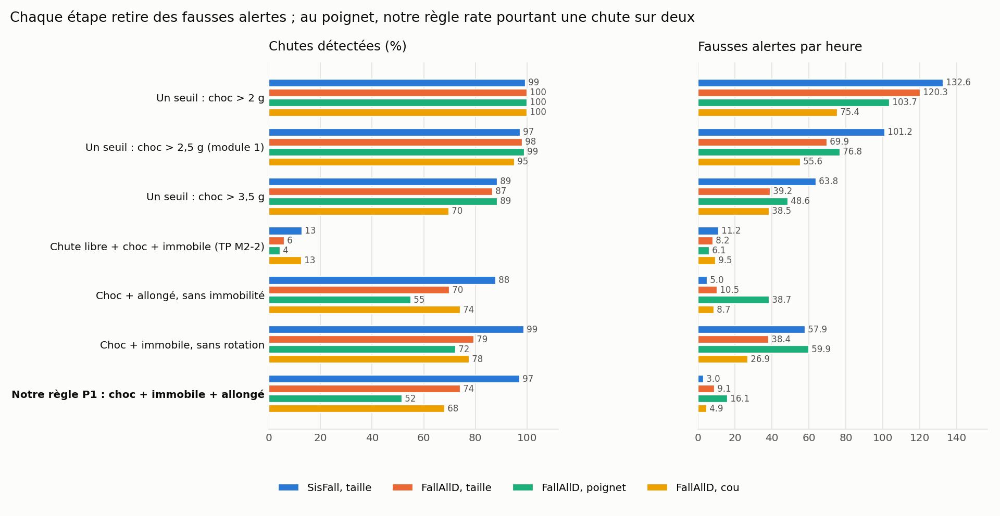
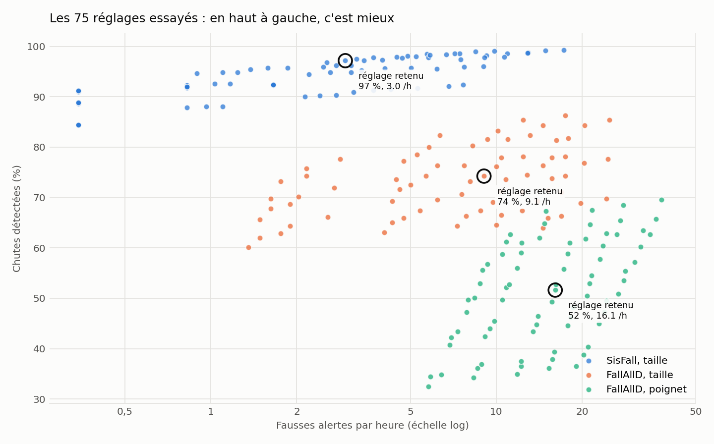

# Benchmark de notre règle de chute, à la taille et au poignet

Généré par `projet1/traitement/benchmark_regles.py`. **Ce ne sont pas nos enregistrements** : deux jeux publics, SisFall (Sucerquia et al., *Sensors*, 2017) et FallAllD (Saleh et al., *IEEE Sensors Journal*, 2021), dans la version prétraitée de github.com/mlgig/ts_fall_detection. Chutes simulées sur tapis par des volontaires. On y fait tourner **nos** règles, avec les réglages du firmware P1.

Contrôle : la version rapide de la règle P1 (balayage) et la version de référence diffèrent sur 0 essais sur 800.

| Jeu | Chutes | Essais de la vie courante | Durée de vie courante |
| --- | --- | --- | --- |
| SisFall, taille | 1798 | 2707 | 14.5 h |
| FallAllD, taille | 466 | 1332 | 7.4 h |
| FallAllD, poignet | 523 | 1992 | 11.1 h |
| FallAllD, cou | 733 | 1559 | 8.7 h |

## 1. Sept règles, de la plus simple à la nôtre

On ajoute ou on retire une étape à la fois pour voir ce que chacune apporte.

### SisFall, taille

| règle | chutes détectées | essais de la vie courante avec fausse alerte | fausses alertes / h |
| --- | --- | --- | --- |
| Un seuil : choc > 2 g | 1787 / 1798 (99.4 %) | 1046 / 2707 | 132.6 |
| Un seuil : choc > 2,5 g (module 1) | 1751 / 1798 (97.4 %) | 780 / 2707 | 101.2 |
| Un seuil : choc > 3,5 g | 1592 / 1798 (88.5 %) | 496 / 2707 | 63.8 |
| Chute libre + choc + immobile (TP M2-2) | 232 / 1798 (12.9 %) | 162 / 2707 | 11.2 |
| Choc + allongé, sans immobilité | 1581 / 1798 (87.9 %) | 73 / 2707 | 5.0 |
| Choc + immobile, sans rotation | 1774 / 1798 (98.7 %) | 770 / 2707 | 57.9 |
| **Notre règle P1 : choc + immobile + allongé** | 1747 / 1798 (97.2 %) | 42 / 2707 | 3.0 |

### FallAllD, taille

| règle | chutes détectées | essais de la vie courante avec fausse alerte | fausses alertes / h |
| --- | --- | --- | --- |
| Un seuil : choc > 2 g | 466 / 466 (100.0 %) | 682 / 1332 | 120.3 |
| Un seuil : choc > 2,5 g (module 1) | 457 / 466 (98.1 %) | 408 / 1332 | 69.9 |
| Un seuil : choc > 3,5 g | 404 / 466 (86.7 %) | 238 / 1332 | 39.2 |
| Chute libre + choc + immobile (TP M2-2) | 28 / 466 (6.0 %) | 61 / 1332 | 8.2 |
| Choc + allongé, sans immobilité | 326 / 466 (70.0 %) | 78 / 1332 | 10.5 |
| Choc + immobile, sans rotation | 370 / 466 (79.4 %) | 283 / 1332 | 38.4 |
| **Notre règle P1 : choc + immobile + allongé** | 346 / 466 (74.2 %) | 67 / 1332 | 9.1 |

### FallAllD, poignet

| règle | chutes détectées | essais de la vie courante avec fausse alerte | fausses alertes / h |
| --- | --- | --- | --- |
| Un seuil : choc > 2 g | 523 / 523 (100.0 %) | 981 / 1992 | 103.7 |
| Un seuil : choc > 2,5 g (module 1) | 517 / 523 (98.9 %) | 740 / 1992 | 76.8 |
| Un seuil : choc > 3,5 g | 463 / 523 (88.5 %) | 485 / 1992 | 48.6 |
| Chute libre + choc + immobile (TP M2-2) | 23 / 523 (4.4 %) | 68 / 1992 | 6.1 |
| Choc + allongé, sans immobilité | 288 / 523 (55.1 %) | 427 / 1992 | 38.7 |
| Choc + immobile, sans rotation | 378 / 523 (72.3 %) | 639 / 1992 | 59.9 |
| **Notre règle P1 : choc + immobile + allongé** | 270 / 523 (51.6 %) | 169 / 1992 | 16.1 |

### FallAllD, cou

| règle | chutes détectées | essais de la vie courante avec fausse alerte | fausses alertes / h |
| --- | --- | --- | --- |
| Un seuil : choc > 2 g | 733 / 733 (100.0 %) | 509 / 1559 | 75.4 |
| Un seuil : choc > 2,5 g (module 1) | 698 / 733 (95.2 %) | 384 / 1559 | 55.6 |
| Un seuil : choc > 3,5 g | 511 / 733 (69.7 %) | 273 / 1559 | 38.5 |
| Chute libre + choc + immobile (TP M2-2) | 94 / 733 (12.8 %) | 82 / 1559 | 9.5 |
| Choc + allongé, sans immobilité | 544 / 733 (74.2 %) | 74 / 1559 | 8.7 |
| Choc + immobile, sans rotation | 569 / 733 (77.6 %) | 229 / 1559 | 26.9 |
| **Notre règle P1 : choc + immobile + allongé** | 499 / 733 (68.1 %) | 42 / 1559 | 4.9 |

## 2. Le réglage retenu dans le compromis

75 réglages essayés : seuil de choc 1,5 à 3 g, immobilité (écart-type) 0,03 à 0,08 g, rotation 30 à 70°. Dernière colonne : nombre de réglages qui feraient mieux sur un critère sans faire pire sur l'autre.

| Jeu | Réglage retenu (2 g, 0,05 g, 50°) : détectées / fausses alertes | Réglages qui le dominent |
| --- | --- | --- |
| SisFall, taille | 97.2 % / 3.0 par h | 0 sur 74 |
| FallAllD, taille | 74.2 % / 9.1 par h | 11 sur 74 |
| FallAllD, poignet | 51.6 % / 16.1 par h | 14 sur 74 |
| FallAllD, cou | 68.1 % / 4.9 par h | 4 sur 74 |

## 3. Délai entre le choc et la décision (chutes détectées par P1)

La décision tombe quand 3 s d'immobilité sont trouvées. Le bracelet sonne ensuite 15 s (bouton ANNULER) avant d'envoyer l'alerte.

| Jeu | Délai médian | 90 % des chutes en moins de | Alerte au soignant (médiane, avec les 15 s) |
| --- | --- | --- | --- |
| SisFall, taille | 4.0 s | 6.3 s | 19 s |
| FallAllD, taille | 4.1 s | 13.0 s | 19 s |
| FallAllD, poignet | 4.2 s | 12.2 s | 19 s |
| FallAllD, cou | 4.0 s | 11.7 s | 19 s |

## Figures

