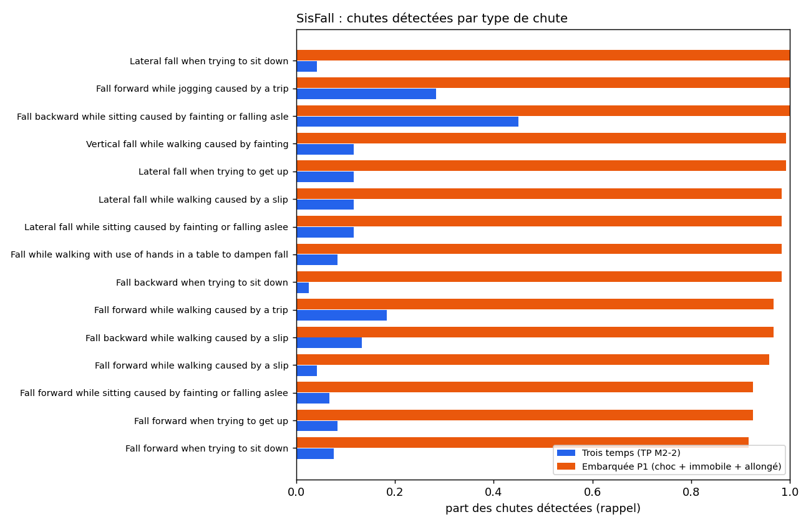
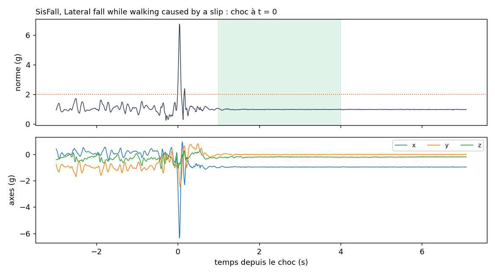

# Projet 1 : nos règles de chute sur le jeu public SisFall

Généré par `projet1/traitement/analyse_sisfall.py`. **Ce ne sont pas nos enregistrements** : 
SisFall (Sucerquia et al., *Sensors* 17(1):198, 2017), capteur à la taille, chutes simulées sur tapis 
par des volontaires. On y fait tourner **nos** trois règles, avec les paramètres du firmware P1.

4505 essais : 1798 chutes, 2707 activités de la vie courante (14.5 h, dont 893 essais de seniors, 5.0 h).

## Toutes les activités de la vie courante

| règle | chutes détectées | rappel | essais de la vie courante avec fausse alerte | précision (par essai) | fausses alertes / h |
| --- | --- | --- | --- | --- | --- |
| Naïve du module 1 (> 2,5 g) | 1751 / 1798 | 0.974 | 780 / 2707 | 0.692 | 101.2 |
| Trois temps (TP M2-2) | 232 / 1798 | 0.129 | 162 / 2707 | 0.589 | 11.2 |
| Embarquée P1 (choc + immobile + allongé) | 1747 / 1798 | 0.972 | 42 / 2707 | 0.977 | 3.0 |

## Activités de la vie courante des seniors seulement

| règle | chutes détectées | rappel | essais seniors avec fausse alerte | précision (par essai) | fausses alertes / h |
| --- | --- | --- | --- | --- | --- |
| Naïve du module 1 (> 2,5 g) | 1751 / 1798 | 0.974 | 158 / 893 | 0.917 | 82.2 |
| Trois temps (TP M2-2) | 232 / 1798 | 0.129 | 18 / 893 | 0.928 | 3.6 |
| Embarquée P1 (choc + immobile + allongé) | 1747 / 1798 | 0.972 | 16 / 893 | 0.991 | 3.4 |

## Les activités qui déclenchent le plus de fausses alertes (nombre d'alertes)

| activite | alertes_naive | alertes_trois_temps | alertes_p1 |
| --- | --- | --- | --- |
| Jogging quickly | 361 | 0 | 0 |
| Jogging slowly | 347 | 0 | 0 |
| Sitting a moment trying to get up and collapse into a chair | 152 | 11 | 0 |
| Walking upstairs and downstairs quickly | 151 | 20 | 0 |
| Stumble while walking | 120 | 0 | 0 |
| Gently jump without falling (trying to reach a high object) | 120 | 110 | 0 |
| Quickly sit in a half height chair wait a moment and up quickly | 72 | 5 | 0 |
| Quickly sit in a low height chair wait a moment and up quickly | 49 | 16 | 3 |

## Les types de chute que la règle P1 rate le plus (part ratée)

| activite | ratee |
| --- | --- |
| Fall forward when trying to sit down | 0.08 |
| Fall forward when trying to get up | 0.08 |
| Fall forward while sitting caused by fainting or falling asleep | 0.08 |
| Fall forward while walking caused by a slip | 0.04 |
| Fall backward while walking caused by a slip | 0.03 |

## Figures

